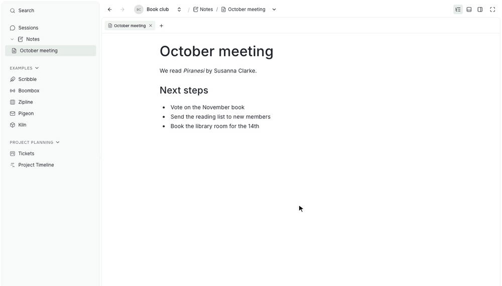
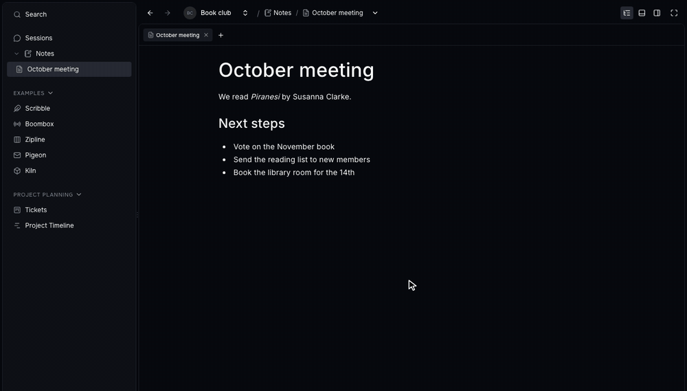

# Write a blog post

Blog posts live in `clients/landing-page/src/content/blog/`. Read the repository `MISSION.md` and the blog section of `documentation/guides/0001-documentation.md` first.

## Shape of a release post

A release post shows the release. Readers should understand each change from its picture, chart, or code example. The text only names the change and says why it helps.

- Start with one or two sentences that name the main changes. Omit slogans and mood-setting introductions.
- Give each feature a concrete heading, such as "Panels", "Main fullscreen", or "Chat links". Avoid vague headings such as "Faster everywhere else".
- Open each section with one or two short sentences: what you can do now, and why it helps. Then show it.
- Order sections by user impact. Put visible workbench changes first, then agent workflows, then extension and SDK changes.
- Keep infrastructure work that people cannot see yet brief. Use one sentence and a few bullets, and say what is not available yet.
- End with an "Other improvements" section of one-line bullets for smaller changes, such as a Windows drive picker. Then add "Release sources".
- Distinguish workbench features from extension workflows. Name the extension that owns a feature, such as Project Planner.
- Cover every relevant change, but group small ones into "Other improvements". Leave out internal refactors.
- Keep paragraphs to one or two sentences. Do not add notes such as "Recorded on a development build".

Use the narrative style only for `thoughts` and `tool showcase` posts.

## Pick the media for each section

Every section about something people can see has a GIF or a screenshot. Pick the media by what the section explains:

| Section explains | Show |
| --- | --- |
| A visible workflow or movement | A GIF |
| A static control, layout, or result | A screenshot |
| A measured speedup or benchmark | A bento chart |
| SDK, extension API, or runtime API changes | A highlighted `ts` code block |
| New or changed CLI commands | A highlighted `sh` code block with the commands, plus sample output when it helps |
| Work with nothing to see yet | A short list, no media |

Do not show the same result twice. If a chart shows a speedup, do not add a GIF of the same speedup.

## Benchmark charts

Show a chart whenever a section reports measured results, such as benchmarks or performance budgets. Put one or two sentences before the chart that say what changed to make it faster. Put one line after it that names the workload and links the benchmark write-ups.

Draw charts as a bento grid with [`scripts/bento-chart.ts`](scripts/bento-chart.ts):

```sh
bun .pstdio/extensions/pstdio-dev/skills/write-blog-post/scripts/bento-chart.ts \
  documentation/images/<post-slug>-performance.json \
  documentation/images/<post-slug>-performance
```

The spec is a JSON list of tiles. Commit it next to the SVGs so the chart can be redrawn:

```json
[
  { "kind": "bars", "title": "Move a ticket on a 1,000-ticket board", "before": { "value": 2950, "label": "2.95 s" }, "after": { "value": 31, "label": "31 ms" }, "wide": true },
  { "kind": "number", "title": "Board after a restart", "value": "< 2 s" }
]
```

- Use only two tile kinds: `bars` for a before and after pair, and `number` for one result without a baseline.
- Give each tile one short title. Do not add subtitles, axes, or legends.
- Use at most four to six tiles. Make bar tiles `wide` and pair number tiles, so text stays readable on a phone.
- Label bars "Before" and "After". Use version numbers only when the baseline was measured on the previous release itself.
- Use only numbers from a benchmark write-up or pull request. Never invent a "before" value. Use a `number` tile when there is no baseline.
- Drop measurements readers cannot relate to, such as an isolated database lookup. Keep them in the linked write-up.
- The script writes paired `-light.svg` and `-dark.svg` files with the `@pstdio/ui` chart colors. Its SVG title lists every value; use the same text as the image alt text.
- When you change the chart colors, check them with the dataviz skill's palette validator for both themes.

## Code examples

For SDK, extension API, and CLI changes, show what the change lets people build. Do not list every new method.

- Introduce each code block with one sentence about what it enables, such as "Test what happens when two people edit the same data offline."
- Keep examples short and realistic. Break lines before they reach about 90 characters so the block does not scroll sideways.
- Run every example against the real SDK or CLI before publishing, and type-check TypeScript examples. Use the SDK's test helpers, such as `@pstdio/sdk/testing`, as a stand-in for `ctx`.
- Follow the examples with short bullets for smaller API additions.

## GIFs and screenshots

Record real UI interactions with Playwright against an isolated stack. Use a disposable project with sample content.

- Start a fresh stack with its own name, such as `bun ./scripts/dev/dev-isolated.ts --name blog-<version>`, so other agents cannot tear it down. Stop it with `--name blog-<version> --down` when you finish.
- The launcher can time out while the container keeps starting. Watch the container log for `Opened project` instead of restarting.
- Rename the seeded project only after setup finishes. The startup script looks up the project by its name, "project".
- Seed data through the command API with the container's `PSTDIO_ISOLATED_API_TOKEN`. Use realistic titles, not "Stress ticket 0001".
- Record one workflow per clip. Load data once before recording, so the clip shows the feature rather than a loading state.
- Match the sample data, actions, framing, and speed in the light and dark takes. Reset the state between takes, for example by moving cards back.
- Show a visible cursor. Move it to the target, pause briefly, and show click feedback. Leave time to read the result.
- Headless screen captures leave out the browser's drag image. Show a translucent copy of the dragged item that follows the cursor.
- Capture PNG frames with the Chrome DevTools screencast, not WebM video. WebM noise makes GIFs several times larger.
- Crop out unrelated floating buttons, such as the chat bubble, and keep unrelated panels closed.
- Use examples that match each tool's purpose. For example, Project Search finds content in the project, not on the web.
- Never include credentials, personal paths, or private conversations.
- Keep capture scripts, frames, and tokens in the worktree's ignored `__test-tmp__/` folder.

Commit only the exported media in `documentation/images/`, named with the post slug, such as `prompt-studio-0-45-panels-light.gif`. Do not commit MP4 or WebM files. Export matching `-light` and `-dark` files. The site shows only the variant for the active theme for GIF and SVG files.

Add both variants with the same alt text, followed by one short caption:

```md




Drop the note tab on the right edge, then move Side to the left of the board.
```

## Banners

Give each post its own 1600 × 400 banner pair from the Shape Art extension. Follow the [Shape Art skill](../../../shape-art/skills/shape-art/SKILL.md).

- Generate the dark piece as `blog-<post-slug>` on the ink background, and the light piece as `blog-<post-slug>-light` with the same seed on paper.
- Allow all six shape kinds, including the yellow command and orange automation shapes.
- `pst shape-art` writes to the main checkout's `design/art/`. Move each PNG and its JSON recipe into `clients/landing-page/src/content/blog/images/`.

## Frontmatter and sources

- Release titles contain only the product name and version, such as `Prompt Studio 0.45`. Put details in the description and body.
- Include `title`, a short `description`, an unquoted `published` date or UTC timestamp, `author: aurelien-franky`, one `category`, and paired `image.light` and `image.dark` paths. Release posts use `category: release`.
- Do not store reading time. Do not repeat the alpha notice; the site adds it.
- Check published GitHub releases, excluding drafts. Read the core, SDK, UI, workbench, and relevant extension changelogs for the release.
- Before the release ships, read the pending changesets and merged pull requests, and link sources at a fixed commit.
- Use the release's actual publication timestamp. Keep an existing publication date when you correct or illustrate a post.

## Drafts

Save unpublished posts as `drafts/<slug>.md` in the blog folder. The blog loader reads only top-level files, so drafts get no page, search entry, or sitemap entry. Never put drafts in `public/`.

- Write drafts in their final release voice. Drafts may omit `published` and banner paths.
- Links from a draft to `documentation/` need one more `../` than links from a published post.
- Before you finish, check the release with `gh release view pstdio@<version> --json isDraft,publishedAt`. If it is published, publish the post in the same task. If not, create a planner ticket named "Publish the Prompt Studio <version> release post".

To preview a draft, copy it to the top-level blog folder with a placeholder `published` date and banner paths, fix the relative paths, build, and run `bunx astro preview` in `clients/landing-page`. Delete the copy before you commit.

## Publish a draft

Publish a release post as soon as its GitHub release is published, in one pull request:

1. Run `gh release view pstdio@<version> --json isDraft,publishedAt`. Continue only if `isDraft` is `false`.
2. Compare the draft with the release notes and the changelogs at the release tag. Add missing features and remove work that did not ship.
3. Move the file with `git mv drafts/<slug>.md <slug>.md`.
4. Fix relative paths. Banners change from `../images/` to `./images/`, and links to `documentation/` lose one `../`.
5. Add `published: <publishedAt>` as an unquoted UTC timestamp, and check that both banners exist.
6. Point the release sources at the release notes and the release tag.
7. Follow the verification steps below. The production build must include the article, document JSON, blog index entry, search entry, and sitemap entry.

## Verification

- Check every claim against the release sources. Check metadata, relative paths, captions, and links.
- Build the landing page with `bun run --cwd clients/landing-page build`. Do not add tests for posts, media, or collection configuration.
- For a draft, check that the build has no article, search entry, or sitemap entry for its slug.
- Use Playwright to check the article and the blog index on desktop and mobile in both themes. Check that each theme shows only its own media, that nothing overflows, and that code blocks do not scroll sideways.
- Check that every served GIF is still animated. The site serves GIFs as animated WebP, so count the `ANMF` frames in the built file.
- Posts and media need no changeset.
