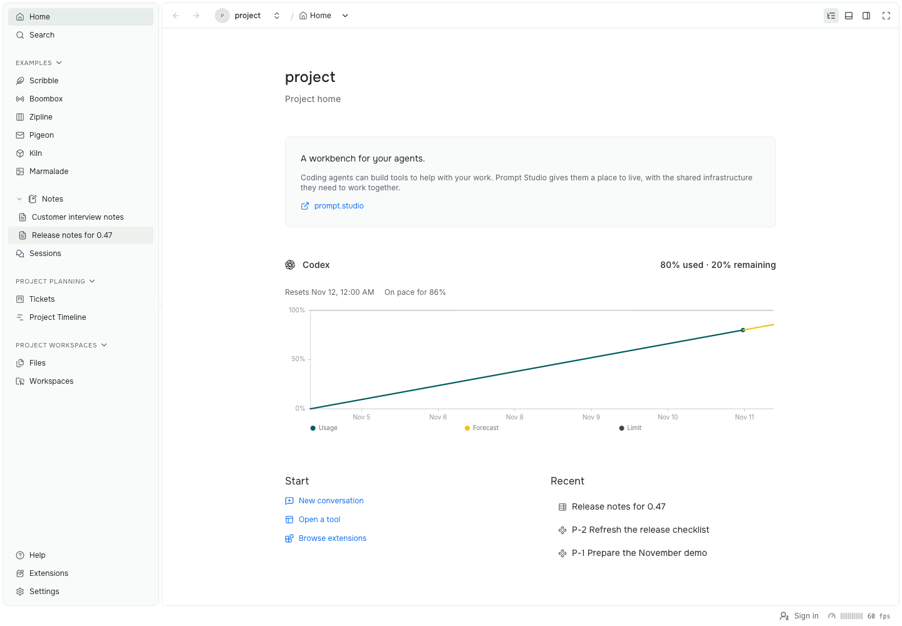
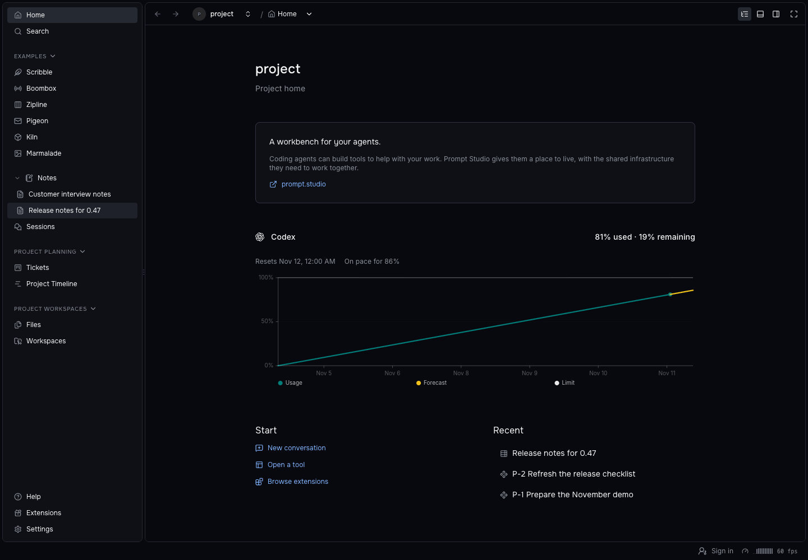
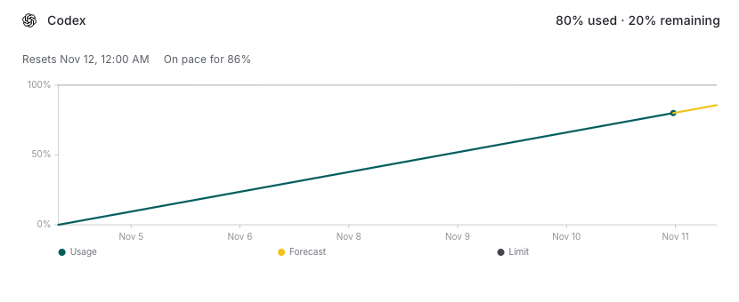
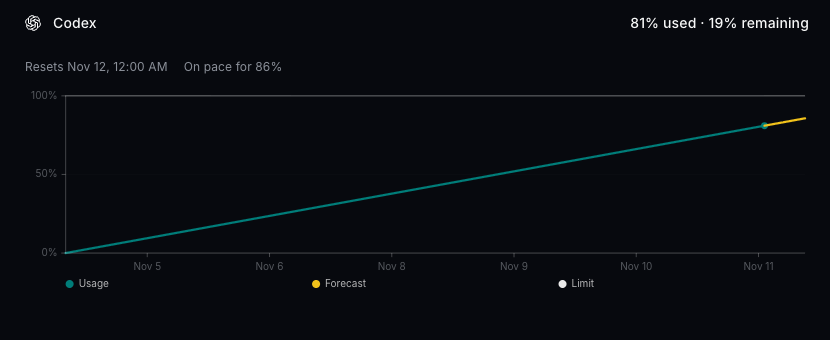
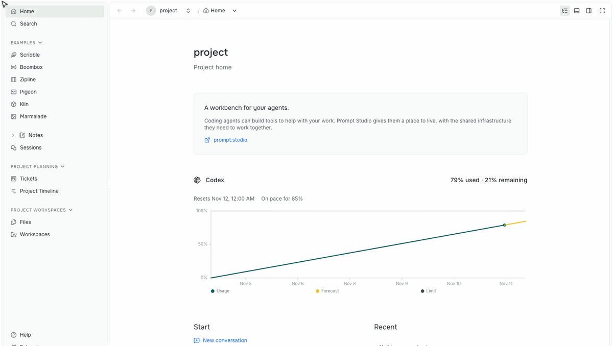
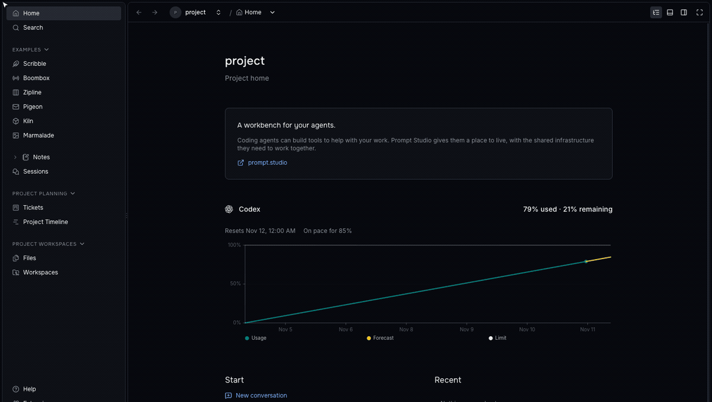
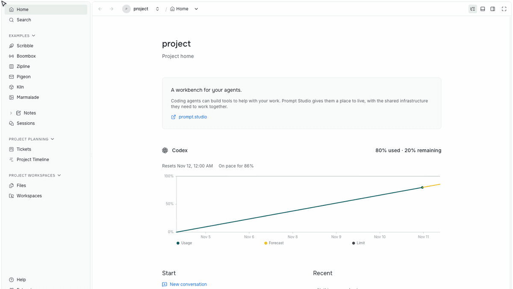
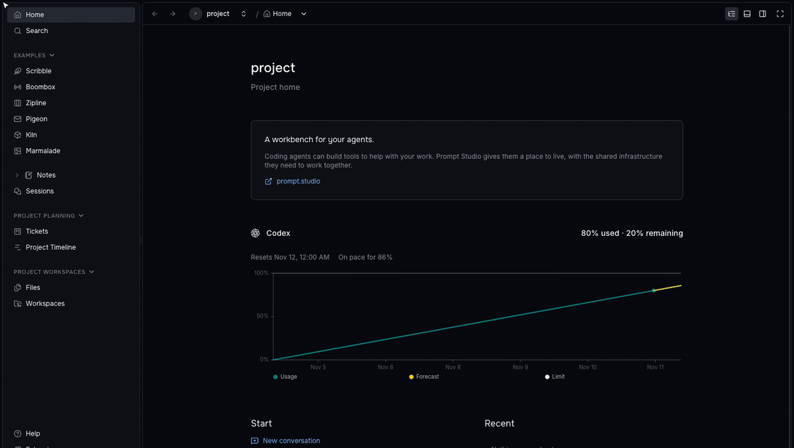
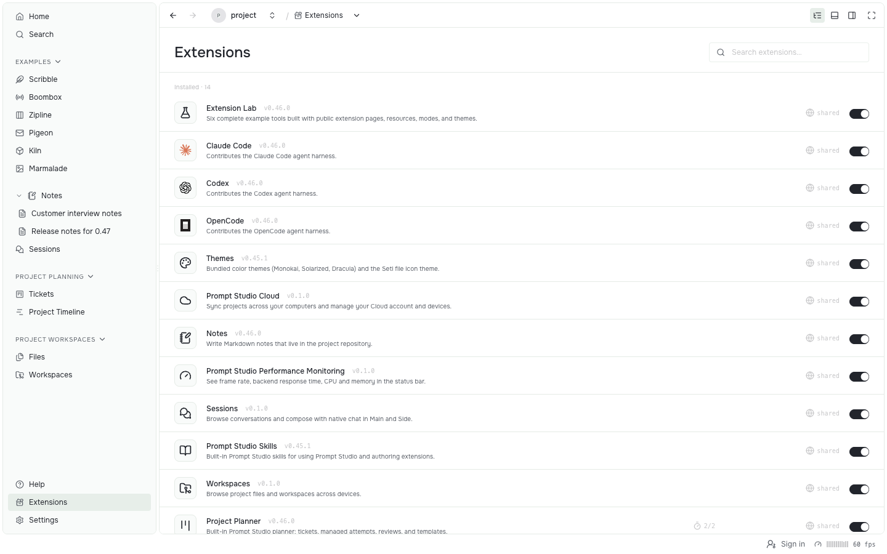
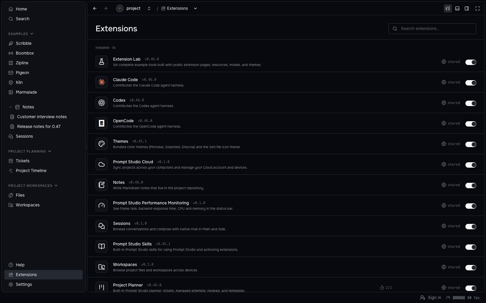

Prompt Studio 0.47 turns Home, Sessions and Workspaces into bundled tools with their own pages and settings. Conversations fork from a selected reply, new projects choose their agents and tools, and extension API 0.4 adds ordered storage with shared text and native terminals.

## Home

Project Home shows the resources you opened most recently, existing work actions, setup recovery, and agent quota charts. Each project owns an editable copy under `.pstdio/extensions/pstdio-home/`.





Home is an extension, so you can modify it. Ask your agent to add something you'd like to see there. One thing we extended it with is usage graphs for all harnesses.





The Codex usage graph on Home. It records readings hourly, keeps eight days of history, and forecasts the current period.

## Sessions and Workspaces

Sessions and Workspaces are bundled tools you can open, disable, or replace. Workspaces groups your workspaces and their sessions, and lets you change this computer's active workspace limit.





Open a session, return to the project, then switch how Workspaces groups its list.

Sessions keeps date groups and loads older conversations as you scroll. The composer and queue stay attached to the session.

- Workspaces offers project Files, native file editing, lazy Git comparisons, and workspace actions in context menus.
- Sessions and Workspaces install once for your user and are available across your projects.
- Terminal views can now be declared by installed tools and run in the workbench's own terminal.

## Fork a conversation

Fork a conversation from any agent reply. The new session keeps the history through that reply, then waits for your next prompt while the source conversation keeps running.





Hover an agent reply, choose the fork icon, and keep the history through that reply.

```sh
pst sessions fork --id <session-id> \
  --message-id <message-id>
```

Forking needs a harness with native fork support. Drafts do not show Fork.

## Extensions and settings

Extensions now sits between Help and Settings, with Tool Case, fixed page headers, detail tabs, and nested navigation. Extension-owned SVG icons appear in the list, and searching a full extension ID finds it.





Search by name or full ID, then open a tool's details.

Settings share one header for Save and Reset, group related controls, and protect unsaved changes when you navigate away. Disabling a project's extensions is also safer: deleting the project now uninstalls the extensions found in its folder.

New projects can ask which agents and tools they should start with. Extensions can offer a `projectSetup` view and install catalog extensions for the project, and a new project enables only the defaults you choose. Home and Onboarding are preinstalled; performance monitoring stays optional, and Workspaces arrives through the Coding setup.

## UI Canvas

UI Canvas now shows the project's own canvases from the build that `pstdio-canvas watch` writes. It no longer ships a prebuilt catalog, and only the frames whose code changed reload.

```sh
bun add -d @pstdio/canvas
bun x pstdio-canvas watch
```

Motion studies and shader versions open in UI Canvas with parameters and saved versions in the right-hand editor, and the selected animation's timeline and transport in the bottom tray. The shared keyframe timeline supports grouped property tracks, frame snapping, loop ranges, and marker review. The catalog is organized by purpose, and in-frame navigation is the default for new canvases. UI Canvas replaces the retired Motion Lab and Shader Lab, so motion reviews, shader versions, and comparison choices now live here.

## Extension API 0.4

Extension API 0.4 is a breaking step for extension authors. Update `@pstdio/sdk` to 0.47.0 and set `engines.pstdio` to `^0.4.0` after adapting your storage use.

The API changes how shared data merges. Records apply in one accepted order with atomic conditional outcomes, so an accepted save no longer depends on arrival time. Fields that people edit together become declared text, and append-only data moves to logs.

```ts
export default defineExtension({
  storage: {
    records: {
      text: [{
        prefix: "note:",
        fields: ["/description"],
      }],
    },
    logs: [{
      name: "runs",
      writer: "project",
      keep: { days: 30 },
    }],
  },
});

const description = ctx.storage.text(
  "note:one",
  "/description",
);
await description.edit([
  {
    kind: "text.insert",
    index: 0,
    text: "Shared with everyone.",
  },
]);
await ctx.storage.log("runs").append({
  result: "passed",
});
```

See the [API 0.4 migration guidance](../../../../../../documentation/references/extensions/0014-api-versioning.md).

- Native chat, terminal, and workspace view bodies render in the host without an extension UI bundle.
- A `projectSetup` view and `ctx.extensions` let an extension choose a new project's tools.
- Extensions can offer grouped resource lists, modal pages, and native file and terminal services through scoped host APIs.
- The SDK adds message actions and forks, tree pages, and retained command queries.

## Faster

Tickets, sessions, and saves now do less repeated work.

- Tickets, Sessions, and the timeline avoid rendering unchanged cards, rows, and context menus.
- Markdown editors publish typing in the background and keep input-owned undo groups.
- Large local saves skip repeated revisions, and paged tables and boards continue across changes made after the previous page.
- Opening extension pages no longer waits for a second catalog read, and deleting a workspace no longer reloads every project's extensions.

## Other improvements

- Project Planner opens review decisions from Auto Build and timeline attention markers, and Auto Build waits when this computer's workspace limit is full.
- Ticket designs can hand off through a `proposals/` folder on the default branch or a pushed branch and commit.
- Review requests stay to 80 words with supporting document links.
- Ticket-linked workspaces, artifacts, and other resources share one badge list with owner navigation.
- Resource groups support context menus, and page dialogs size to their content.
- Data tables add inline sparkline and bar-chart cells, with saved row height.
- Charts use TanStack Charts with consistent palettes, and a shared dependency Gantt chart is available.
- The command palette clarifies names and groups, fills missing icons, and shows assigned shortcut sequences.
- Notes expand from their own chevron, and opening a note no longer reloads the project sidebar.
- Extensions can copy command text results in the dashboard while keeping the browser's user gesture.
- The About panel tagline is now "A workbench for your agents."
- Desktop recovery appears promptly after a runtime crash.
- Codex keeps final results when its app server exits, and OpenCode 2.2.5 adds model discovery, native thinking choices, and recovery after discovery failures.
- Prompt Light and Prompt Dark have slightly clearer subtle borders.
- `pst sessions import` restores exported pre-0.46 session history with resumable jobs, attachments, and original dates.

## Release sources

See the [0.47.0 release notes](https://github.com/pufflyai/prompt-studio/releases/tag/pstdio%400.47.0) and the changelogs at the [`a51e8ca3`](https://github.com/pufflyai/prompt-studio/tree/a51e8ca3d) commit.

- Workbench and tools: [Home](https://github.com/pufflyai/prompt-studio/blob/a51e8ca3d/extensions/pstdio-home/README.md), [Sessions](https://github.com/pufflyai/prompt-studio/blob/a51e8ca3d/extensions/pstdio-session-browser/README.md), [Workspaces](https://github.com/pufflyai/prompt-studio/blob/a51e8ca3d/extensions/pstdio-workspaces/extension.ts), [Extensions page](https://github.com/pufflyai/prompt-studio/blob/a51e8ca3d/packages/pstdio/CHANGELOG.md#0470).
- Forks: [`pst sessions fork`](https://github.com/pufflyai/prompt-studio/blob/a51e8ca3d/documentation/references/cli/0006-sessions.md), [native chat views](https://github.com/pufflyai/prompt-studio/blob/a51e8ca3d/documentation/references/extensions/0028-native-chat.md).
- Extension API: [API versioning](https://github.com/pufflyai/prompt-studio/blob/a51e8ca3d/documentation/references/extensions/0014-api-versioning.md), [storage](https://github.com/pufflyai/prompt-studio/blob/a51e8ca3d/documentation/references/sdk/0004-storage.md), [native terminals](https://github.com/pufflyai/prompt-studio/blob/a51e8ca3d/documentation/references/extensions/0022-terminal-sessions.md).
- UI Canvas: [project builds](https://github.com/pufflyai/prompt-studio/blob/a51e8ca3d/extensions/canvas/README.md), [`@pstdio/canvas`](https://www.npmjs.com/package/@pstdio/canvas).
- Extension changelogs: [Project Planner](https://github.com/pufflyai/prompt-studio/blob/a51e8ca3d/extensions/pstdio-planner/CHANGELOG.md#0470), [Notes](https://github.com/pufflyai/prompt-studio/blob/a51e8ca3d/extensions/pstdio-notes/CHANGELOG.md#0461), [Home](https://github.com/pufflyai/prompt-studio/blob/a51e8ca3d/extensions/pstdio-home/CHANGELOG.md#020), [Sessions](https://github.com/pufflyai/prompt-studio/blob/a51e8ca3d/extensions/pstdio-session-browser/CHANGELOG.md#020), [Workspaces](https://github.com/pufflyai/prompt-studio/blob/a51e8ca3d/extensions/pstdio-workspaces/CHANGELOG.md#020), [UI Canvas](https://github.com/pufflyai/prompt-studio/blob/a51e8ca3d/extensions/canvas/CHANGELOG.md#010).
