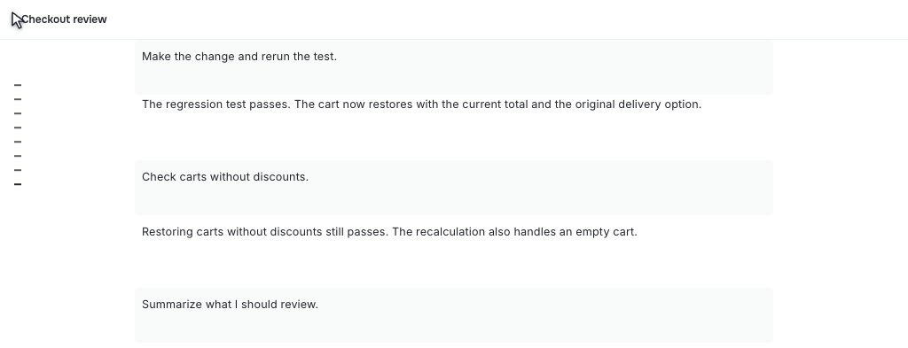
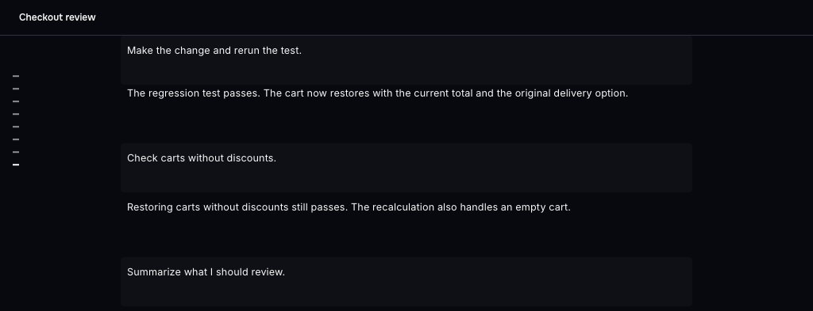
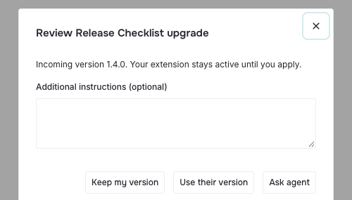
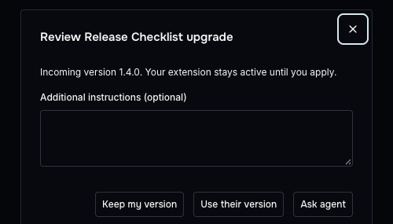
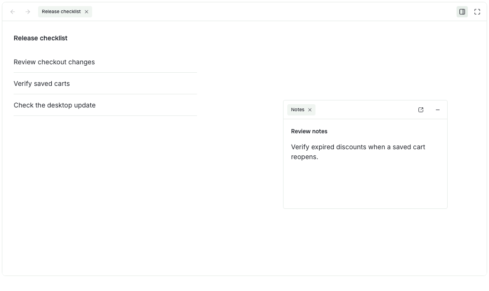
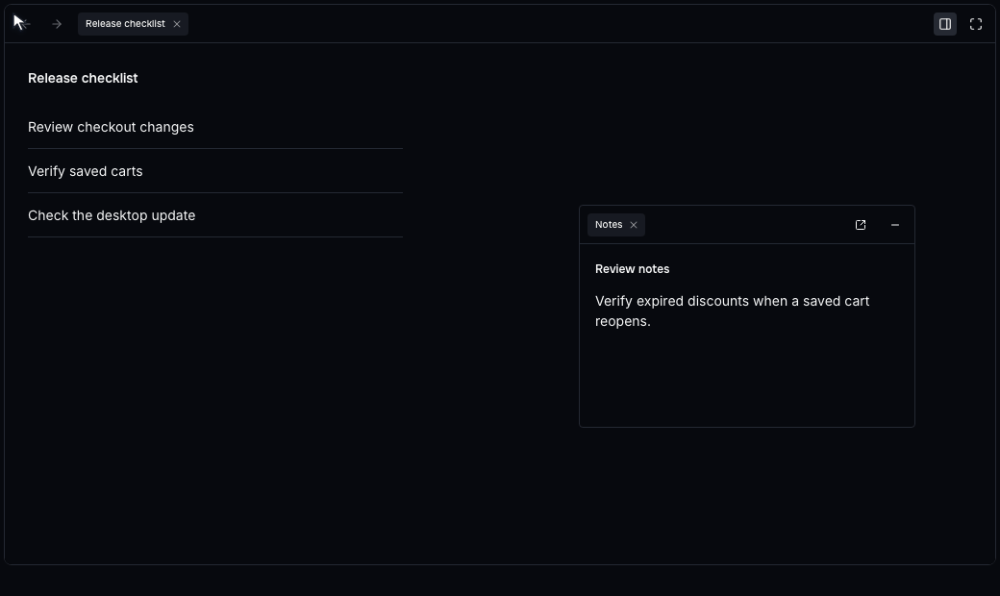
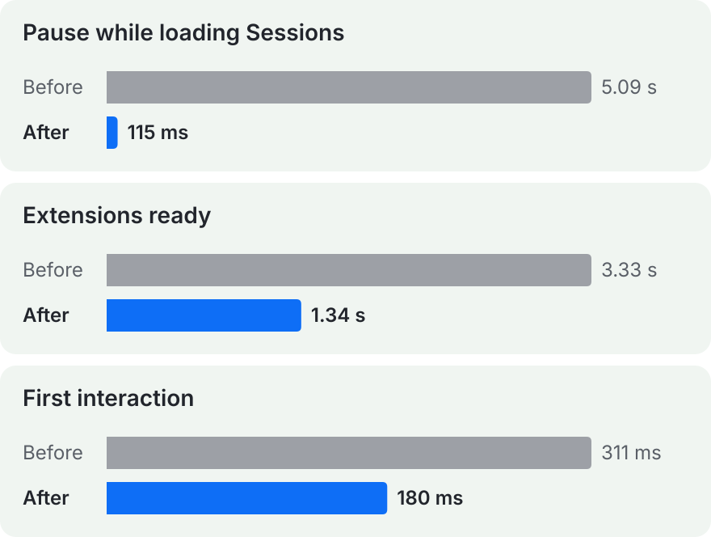
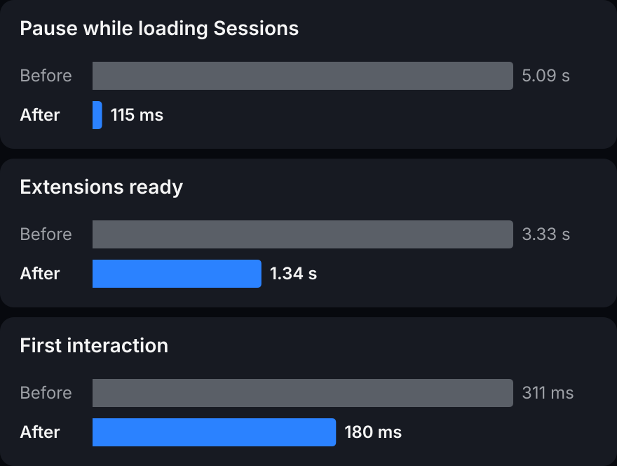

Prompt Studio 0.49 makes long conversations easier to navigate and gives you more control over what happens when a tool you’ve customized gets an update. You can also put the floating Side Panel where it fits your work and open large ticket boards as soon as the first cards are ready.

## Find your place in a conversation

Use the outline beside a conversation to jump back to a decision. Hover over a mark to preview its prompt and reply, then select it to go to that turn.

Jump back to the decision about where to revalidate a discount, then return to the latest reply.

If another session sent a message, its avatar in the message actions opens the conversation it came from. Repeated polling prompts and errors now show a count. [Sender avatars](https://github.com/pufflyai/prompt-studio/pull/2458), [repeated messages](https://github.com/pufflyai/prompt-studio/pull/2265).

Saved sessions also have a short nickname that stays the same when you rename the conversation. Hover over the tab to see it, or use **Copy session nickname** in the session menu. [Session nicknames](https://github.com/pufflyai/prompt-studio/pull/2473).

## Manage app and extension updates

If a published extension update conflicts with your local edits, choose **Resolve** in **Extensions**. You can keep your version, use the published version, or ask an agent to reconcile the two.

Tell the agent which part of the Release Checklist to keep before choosing **Ask agent**.

Return to the review to see the proposed resolution and apply the upgrade. Your current extension stays active while you decide. [Linked agent sessions](https://github.com/pufflyai/prompt-studio/pull/2493).

When a desktop update finishes downloading, **Update available** appears in the status bar. Choose **Restart** when you’re ready to install it. [Desktop update control](https://github.com/pufflyai/prompt-studio/pull/2495).

## Put the Side Panel where you want it

Drag the floating Side Panel to the left, center, or right, or switch to **Move freely**. Resize it from a top corner and Prompt Studio remembers the size.

With **Move freely** enabled, drag Notes by its header to position it over the checklist.

In **Settings → Workbench → Appearance**, choose whether to show the Side Panel bubble and which tab it opens. [Workbench layout guide](https://github.com/pufflyai/prompt-studio/blob/86174ec51/documentation/references/workbench/0001-overview.md#menu-selection-and-the-floating-launcher).

## A more responsive workbench

Projects reopen faster, and Project Planner shows the first page of the Tickets board as soon as it’s ready. Loading a large Sessions history, running long database queries, and using slow tools are less likely to stall the workbench. [Tickets board](https://github.com/pufflyai/prompt-studio/pull/2506), [workbench responsiveness](https://github.com/pufflyai/prompt-studio/pull/2400).

The Sessions test measured a UI pause while loading a copy of saved desktop history. The restart benchmark reopened the same project on the same hosted Mac, with one run per build. [Sessions test](https://github.com/pufflyai/prompt-studio/pull/2420), [restart benchmark](https://github.com/pufflyai/prompt-studio/pull/2532).

## Other improvements

- Reopen a conversation at the latest reply and send reordered follow-ups in the order shown in the queue. [Session queue](https://github.com/pufflyai/prompt-studio/pull/2387).
- Dismiss any item in **System activity** and find dismissed recovery details with **Recover changes**. [System activity](https://github.com/pufflyai/prompt-studio/pull/2546).
- Tools that connect to another service can share one sign-in across projects on the same computer. [Shared connections](https://github.com/pufflyai/prompt-studio/pull/2230).

## Release sources

See the pending 0.49 release notes and the changes behind the conversation outline, upgrade review, and floating Side Panel. [Pending 0.49 release notes](https://github.com/pufflyai/prompt-studio/tree/86174ec518f69c0a2ecb08cf44a547b27d8b2e19/.changeset), [conversation outline](https://github.com/pufflyai/prompt-studio/pull/2427), [extension upgrade review](https://github.com/pufflyai/prompt-studio/pull/2498), [Side Panel](https://github.com/pufflyai/prompt-studio/pull/2333).
