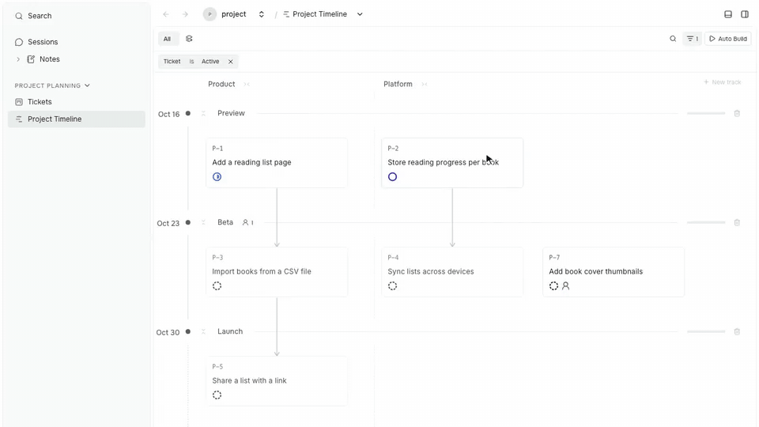
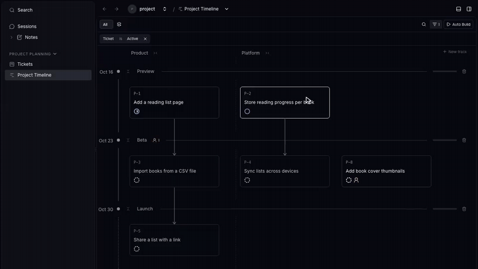
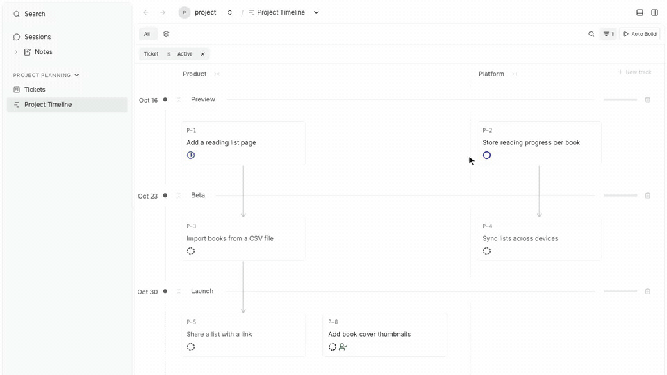
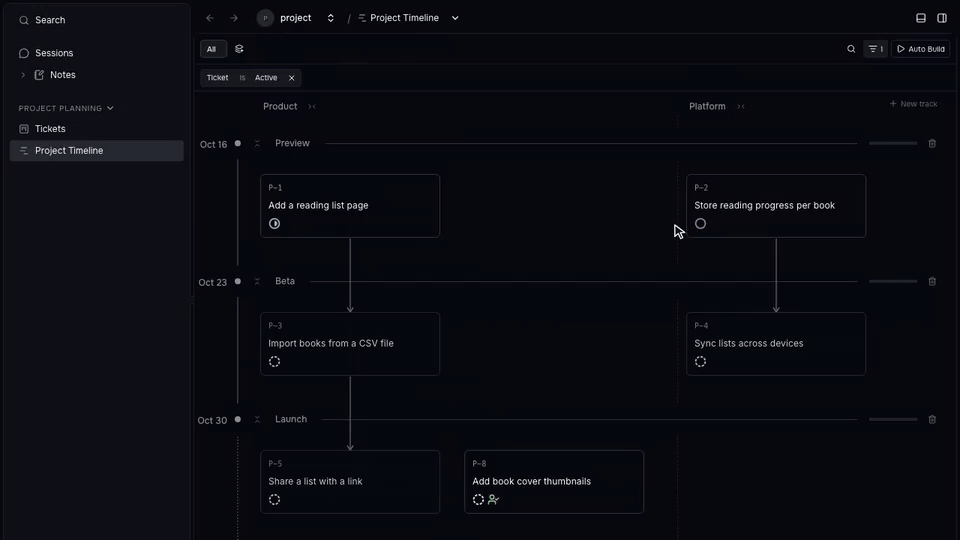
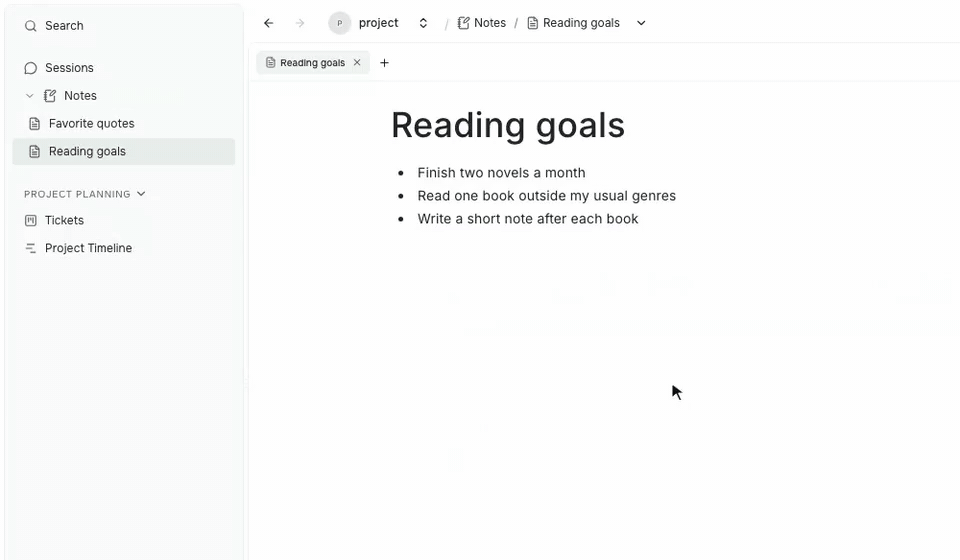
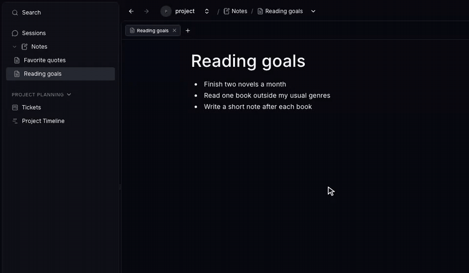

Prompt Studio 0.43 adds a Project Timeline and Auto Build to Planner, folders to Notes, and a Copy link action on every page. Place tickets on tracks and milestones, let a supervisor agent start the ones that are ready, and send someone a link to the exact page you have open.

## Project Timeline

Open **Project Timeline** under **Project Planning** in the project sidebar. It shows the same tickets as **Tickets**, arranged in tracks and milestones, with arrows from each prerequisite to the ticket that waits on it.

Drag Add book cover thumbnails from Platform in Beta to Product in Launch, then open it and answer its review request. Recorded in the isolated 0.43 build with sample Planner tickets.

- Add a track with **New track**, create milestones on the date gutter, and drag tickets between them. Right-click an empty track or milestone to create a ticket there.
- The timeline uses the same saved views, search, and filters as Tickets. A Track rule in the filter also picks which track columns appear.
- Both boards can filter by Milestone, Milestone date, Milestone progress, and Needs attention. Change a ticket's milestone in its Properties panel or by dragging it.
- Each card shows its configured status name, icon, and color. A separate icon shows when a review is requested or answered.

The timeline needs one single-select tag named Track. If Track is set up differently, Tickets keeps working and the timeline explains what to change.

## Auto Build

Click **Auto Build** in the Project Timeline header and describe how to choose work. For example: "Prioritize small independent tickets for the next release. Leave design decisions for me."

Open Auto Build, describe how the supervisor should choose work, and stop ignoring Backlog tickets. Recorded in the isolated 0.43 build with sample Planner tickets, without starting Auto Build.

A supervisor agent reads your prompt, picks valid unassigned tickets, and starts each one in its own Git workspace with the project's default agent. It then sleeps. Planner wakes it every three minutes, and when tickets change or a session finishes, if there is work to start and capacity to run it.

- The ignore filters use the same controls as Tickets. Backlog and Done are ignored by default.
- **Block on review** is on by default. Turn it off to let a ticket start on top of a prerequisite that is still in review.
- **Maximum in-progress tickets** in Planner Settings limits how many tickets run at once. The supervisor does not count toward it.
- The dot on the Auto Build button is green while tickets run, yellow while Auto Build waits, and red if the supervisor fails. Click the button to see the supervisor, each running session, and a stop control.

Stopping Auto Build stops new assignments. Running sessions continue. Auto Build never approves or merges work, and it keeps running after you close the timeline or restart Prompt Studio.

The supervisor works through public Planner commands. `pst pstdio-planner auto-build candidates` lists what can start, and `dispatch` starts a ticket after checking the rules again.

## Review requests

When an agent needs a person, Planner saves a review request on the ticket. A request is a task to confirm or a decision with one or more questions.

Tickets, Project Timeline, chat, and the CLI share one list of requests. Answer a request in the ticket panel, or click a board card that needs input to open its form. Agents answer with `pst pstdio-planner review --request-id <id>`, which replaces `resolve-human-request`.

Review Needed stays on until every open request on the ticket is answered or cancelled. Answering one request never closes another.

When Auto Build is on, the supervisor resumes an answered attempt in its existing workspace and session.

## Ticket creation

The create form keeps your draft and attachments until you close it with X or create the ticket. Clicking outside the form no longer discards it.

Choose **Create ticket** or **Create without opening** from the button menu. Prompt Studio remembers your choice. New tickets also take their properties from the active filters, so they stay visible in the view you created them from.

## Notes folders

Notes and folders now appear directly under **Notes** in the project sidebar. Click **New note** on Notes or a folder to create a note right away, with no dialog.

Create a Book club folder, drag Favorite quotes into it, and add a note that takes its title from its first heading. Recorded in the isolated 0.43 build with sample notes.

- An untitled note takes its title from its first save. Prompt Studio stores the title in Markdown front matter, so later edits do not rename the note.
- Drag notes into folders and reorder them. Two folders cannot share a name, even with different capitalization.
- Notes appear in global search. Rename and Delete are in the note's tab and breadcrumb menus, and deleting asks for confirmation.

The Workspaces entry is now hidden from the sidebar by default.

## Links and artifacts

Open the breadcrumb menu on any page and choose **Copy link**. The link opens the same page, resource, and document. This helps most in the desktop app, which has no address bar.

In the Artifacts library, **Project brief** and **System diagram** each have their own button, which starts a session with the project's agent. Click the Artifacts breadcrumb to return to the library, and rename or delete an artifact from the breadcrumb menu. Published artifacts appear in global search.

## Motion

Tree folders, panels, and floating launchers now open and close with short transitions. In chat, newly streamed text fades in while earlier text stays in place.

Prompt Studio follows your system's reduced motion setting.

## Nightly updates

On macOS and Linux, the desktop app can follow a **Nightly** channel. It installs a signed build of the latest `main` branch, published once a day when `main` changed. Choose it in **Settings → Workbench → Update channel**, or run `pst update-channel nightly`.

Nightlies can have bugs and run new database migrations on your data. The app never installs an older version, so switching back to Stable keeps the nightly until a newer stable release ships. Windows always follows Stable.

The desktop app now checks for updates on launch and every four hours.

## Agents and terminals

- Installing or editing an extension no longer interrupts a running Codex turn. Before, re-provisioning the project's workspaces stopped Codex mid-turn.
- Agent info lists each harness's capabilities and whether it offers models. The model menu is hidden for a harness without models, and you can still send it messages.
- Queued follow-ups appear in the queue as soon as you send them, instead of flashing in the conversation first.
- Links printed by agent CLIs such as Claude Code and Codex open on Ctrl-click or Cmd-click.
- Adding a terminal to the Main or Side panel no longer opens the Secondary Panel.

## Settings

Performance monitoring and connection status now share one **Developer tools** entry under Workbench, next to Update channel. **Machine tokens** appear only after you turn them on in **Experimental → Beta features**.

## Extension APIs

- Set `watch: true` on an artifact mount to get `artifactChanged(mount)` events. Views and hooks that listen to it refresh when an agent, script, or editor changes the files directly.
- `ctx.sessions.query()` pages through sessions with shared filters and returns harness, model, workspace, timing, and saved token totals. A tool author can build a usage dashboard on public APIs alone.
- Controls views can declare a `harness` field. It shows the same agent, model, and options picker as chat, and its value can start a session with `ctx.sessions.create()`.
- Harnesses can declare the `Attachments` capability. Agent info lists it with the harness's other capabilities.
- Command-backed workspace options load in standalone and nested forms, and hidden resource values reach dependent command choices.
- The workflow status APIs are deprecated. Use extension-owned commands, settings panels, and query-owned enums instead. The extension API version is now 0.1.3.

Extension webviews also recover on their own. A webview that failed to build, for example before its dependencies were installed, builds once the extension loads, and a view added by an extension update loads without a restart.

## Fixes

- Chat table cells wrap long content and no longer show row numbers.
- Tooltips appear next to their trigger in chat question steps.
- Trees and other virtual lists draw every row after their page is hidden and shown again.
- Scrollable panels no longer show a browser focus outline.
- Workspaces without local file access no longer show file views.
- A new session stays idle until you send its first message or attachment.

## Release sources

These highlights were checked against the [0.43 release notes](https://github.com/pufflyai/prompt-studio/releases/tag/pstdio%400.43.0) and the changelogs at the [`pstdio@0.43.0`](https://github.com/pufflyai/prompt-studio/tree/559294f1d3005de3f6551fc1d0c7aea93d608bd8) tag.

- [Core changelog](https://github.com/pufflyai/prompt-studio/blob/559294f1d3005de3f6551fc1d0c7aea93d608bd8/packages/pstdio/CHANGELOG.md#0430), [SDK changelog](https://github.com/pufflyai/prompt-studio/blob/559294f1d3005de3f6551fc1d0c7aea93d608bd8/packages/sdk/CHANGELOG.md#0430), [UI changelog](https://github.com/pufflyai/prompt-studio/blob/559294f1d3005de3f6551fc1d0c7aea93d608bd8/packages/ui/CHANGELOG.md#0430), [workbench changelog](https://github.com/pufflyai/prompt-studio/blob/559294f1d3005de3f6551fc1d0c7aea93d608bd8/packages/pstdio-workbench/CHANGELOG.md#0430), and [desktop changelog](https://github.com/pufflyai/prompt-studio/blob/559294f1d3005de3f6551fc1d0c7aea93d608bd8/clients/desktop/CHANGELOG.md#0430).
- [Planner changelog](https://github.com/pufflyai/prompt-studio/blob/559294f1d3005de3f6551fc1d0c7aea93d608bd8/extensions/pstdio-planner/CHANGELOG.md#0430), [Notes changelog](https://github.com/pufflyai/prompt-studio/blob/559294f1d3005de3f6551fc1d0c7aea93d608bd8/extensions/pstdio-notes/CHANGELOG.md#0430), and [Artifacts changelog](https://github.com/pufflyai/prompt-studio/blob/559294f1d3005de3f6551fc1d0c7aea93d608bd8/extensions/pstdio-artifacts/CHANGELOG.md#0430).
- [Project Timeline](https://github.com/pufflyai/prompt-studio/blob/559294f1d3005de3f6551fc1d0c7aea93d608bd8/extensions/pstdio-planner/docs/0005-timeline.md), [Auto Build](https://github.com/pufflyai/prompt-studio/blob/559294f1d3005de3f6551fc1d0c7aea93d608bd8/extensions/pstdio-planner/docs/0007-auto-build.md), [review requests](https://github.com/pufflyai/prompt-studio/blob/559294f1d3005de3f6551fc1d0c7aea93d608bd8/extensions/pstdio-planner/docs/0006-review-requests.md), [update channels](https://github.com/pufflyai/prompt-studio/blob/559294f1d3005de3f6551fc1d0c7aea93d608bd8/documentation/guides/getting-started/0001-install.md#choose-an-update-channel), and [watched mounts](https://github.com/pufflyai/prompt-studio/blob/559294f1d3005de3f6551fc1d0c7aea93d608bd8/documentation/references/extensions/0005-webview-and-storage-api.md#watched-mounts).
