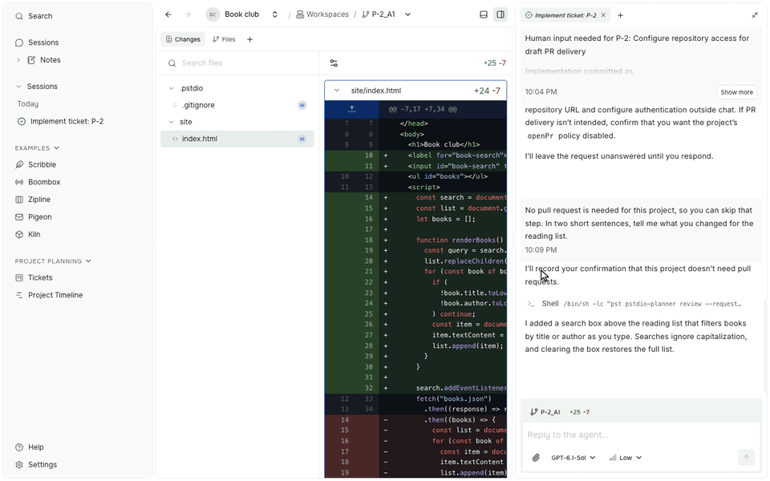
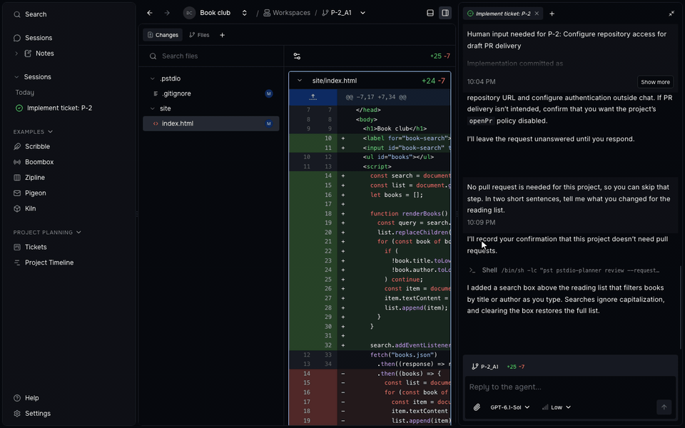
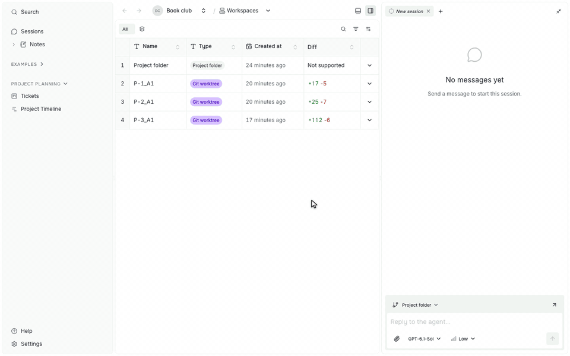
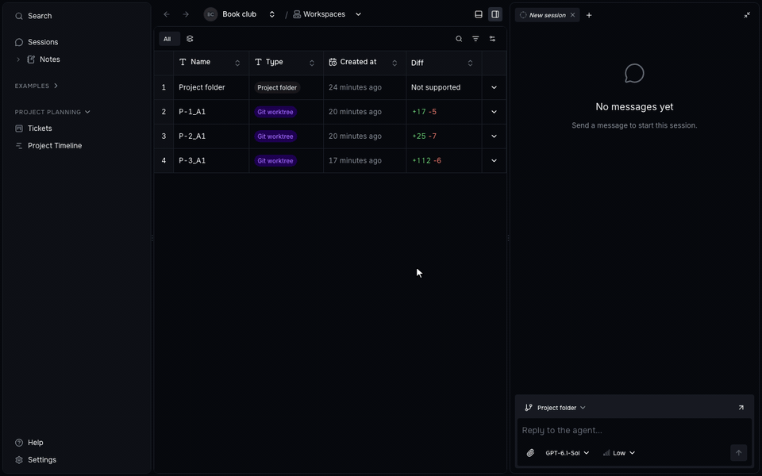
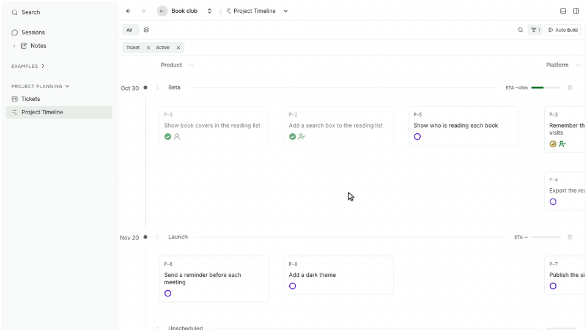
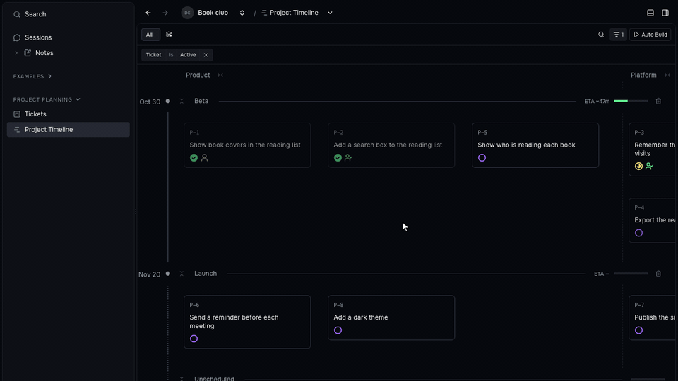

Prompt Studio 0.44 makes it easier to get back to earlier work. Find any past session by name, open a workspace with its conversation already beside it, and let Auto Build keep going while you review.

## Sessions

Choose **Switch session** from a session tab or breadcrumb menu to search every session in the project. Results are sorted by recent activity and show whether each agent is working, waiting for you, or done.

Rename the P-2 session from its tab menu, then type "pira" in Switch session to open Questions for Piranesi in the same tab. Recorded in the isolated 0.44 build with a sample Book club project.

The same menu also archives or deletes a session, and it opens from the sidebar, the tab, or the breadcrumb. Archived sessions leave your lists but keep their conversation. Deleting removes the conversation and leaves the workspace files alone.

## Workspaces open with their conversation

Open a workspace and its latest session appears in the Side panel. You see what the agent did next to the files it changed, without looking for the right conversation.

Open the P-2 workspace, and the session that added the search box appears next to its changes. Recorded in the isolated 0.44 build with a sample Book club project.

The session opens as a preview tab. Opening another workspace replaces the preview, so tabs don't pile up. Drag the tab to keep it open. Turn this off with **Open related resources** in **Settings → Appearance**.

## Auto Build

Auto Build can now start a ticket while the tickets it depends on are still in review. Turn off **Block on review**, and Auto Build builds the new work on top of their submitted changes. Your main branch is not touched.

When those changes conflict, the agent working on the ticket resolves the conflict itself. You are only asked when the requirements disagree, not when the code does.

Auto Build also checks that a finished prerequisite's code is really in the branch before work builds on it. A session that stopped or lost its connection picks up again in the same workspace.

## Project Timeline

Planner is now called Project Planner. Its timeline shows when each milestone will likely be done, based on how fast work has moved so far.

Hover the Beta ETA to see its basis, zoom out with Ctrl+scroll, drag the canvas, and zoom back in on the Platform track. Recorded in the isolated 0.44 build with sample tickets that Codex worked on.

The estimate counts each ticket by its Complexity, so a large ticket weighs more than a small one. It reflects the pace so far, not a deadline.

You can also move around the timeline like a map. Scroll or drag empty space to pan, and pinch or Ctrl+scroll to zoom.

## Extension API 0.2

If you build extensions, this release is a breaking one. It removes the APIs deprecated in 0.43.1. The [migration guide](https://github.com/pufflyai/prompt-studio/blob/d89331b09dec06ed7e6c8538ac7e02a543ad5ad7/documentation/references/extensions/0019-api-0-2-migration.md) lists the replacement for each one.

Extensions can also choose what opens beside their own resources, keep page filters in shared links, and run their own data migrations.

## Release sources

These highlights were checked against the [0.44 release notes](https://github.com/pufflyai/prompt-studio/releases/tag/pstdio%400.44.0) and the changelogs at the [`pstdio@0.44.0`](https://github.com/pufflyai/prompt-studio/tree/d89331b09dec06ed7e6c8538ac7e02a543ad5ad7) tag.

- [Core changelog](https://github.com/pufflyai/prompt-studio/blob/d89331b09dec06ed7e6c8538ac7e02a543ad5ad7/packages/pstdio/CHANGELOG.md#0440), [SDK changelog](https://github.com/pufflyai/prompt-studio/blob/d89331b09dec06ed7e6c8538ac7e02a543ad5ad7/packages/sdk/CHANGELOG.md#0440), [UI changelog](https://github.com/pufflyai/prompt-studio/blob/d89331b09dec06ed7e6c8538ac7e02a543ad5ad7/packages/ui/CHANGELOG.md#0440), and [workbench changelog](https://github.com/pufflyai/prompt-studio/blob/d89331b09dec06ed7e6c8538ac7e02a543ad5ad7/packages/pstdio-workbench/CHANGELOG.md#0440).
- [Project Planner changelog](https://github.com/pufflyai/prompt-studio/blob/d89331b09dec06ed7e6c8538ac7e02a543ad5ad7/extensions/pstdio-planner/CHANGELOG.md#0440).
- [Session actions](https://github.com/pufflyai/prompt-studio/blob/d89331b09dec06ed7e6c8538ac7e02a543ad5ad7/documentation/guides/concepts/0005-sessions.md), [related resources](https://github.com/pufflyai/prompt-studio/blob/d89331b09dec06ed7e6c8538ac7e02a543ad5ad7/documentation/references/workbench/0004-navigation.md#related-resources), [Auto Build](https://github.com/pufflyai/prompt-studio/blob/d89331b09dec06ed7e6c8538ac7e02a543ad5ad7/extensions/pstdio-planner/docs/0007-auto-build.md), [Project Timeline](https://github.com/pufflyai/prompt-studio/blob/d89331b09dec06ed7e6c8538ac7e02a543ad5ad7/extensions/pstdio-planner/docs/0005-timeline.md), and [Extension API 0.2 migration](https://github.com/pufflyai/prompt-studio/blob/d89331b09dec06ed7e6c8538ac7e02a543ad5ad7/documentation/references/extensions/0019-api-0-2-migration.md).
