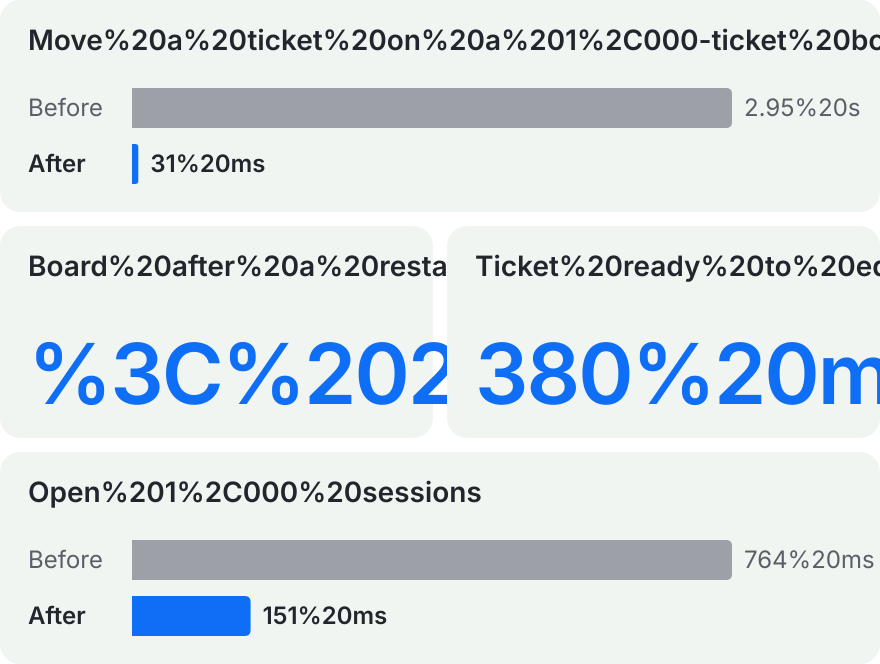
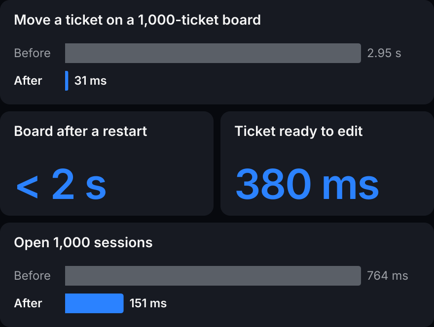
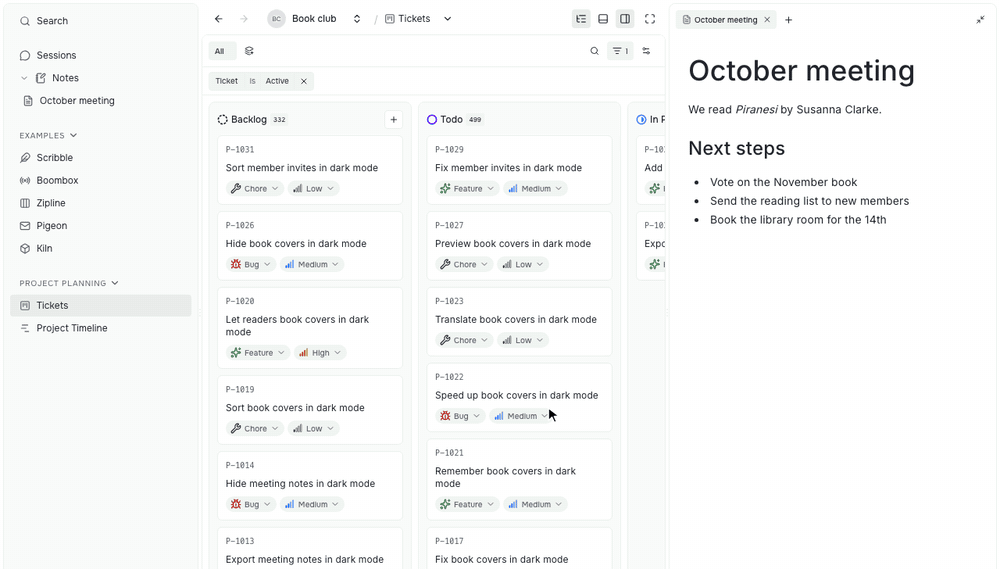
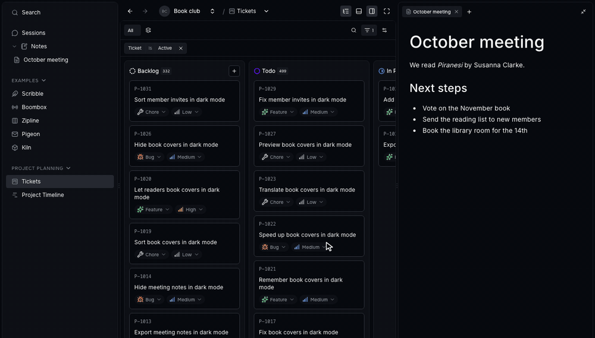
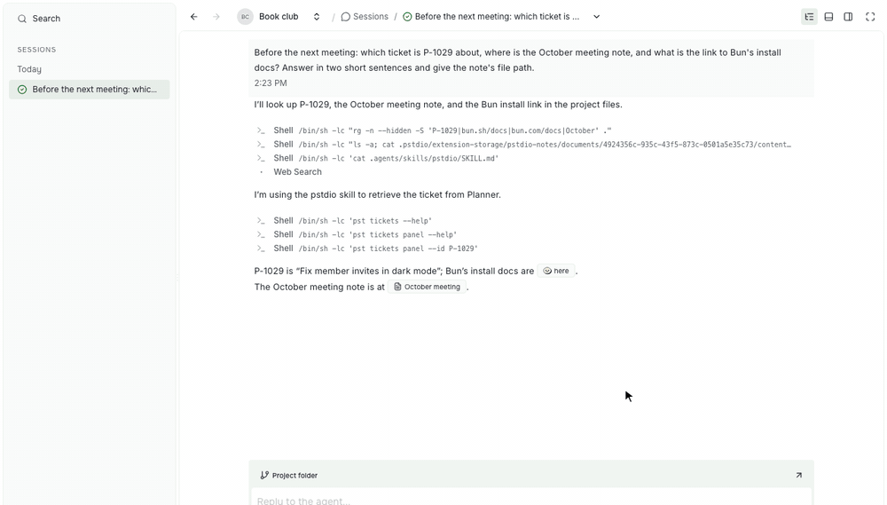
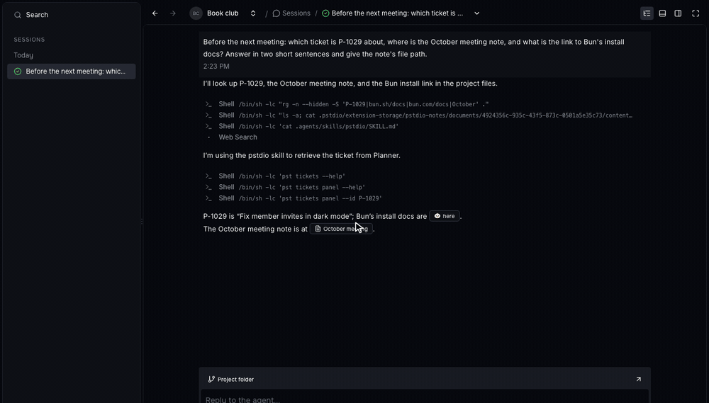

Prompt Studio 0.45 makes large projects faster, lets you move panels and view Main fullscreen, and prepares project data for syncing between your devices.

## Performance

Project Planner now saves only the tickets that moved, and opening a ticket reads only that ticket. Long lists draw only the rows on screen, and a new session returns before its agent finishes starting.





Measured with 1,000 tickets and 1,000 sessions in one project. See the [performance references](https://github.com/pufflyai/prompt-studio/tree/3ad9c7c8017edae7a3c6b14a24c8cd387b6974f1/documentation/references/performance) for every run.

## Panels

Drop a tab on a closed edge to open that panel with it. Drag a whole panel by its header to move it to another edge.


Drop the note tab on the right edge, then move Side to the left of the board.

## Main fullscreen

Expand Main over the whole workbench. Your layout, open editors and running terminals stay as they were, and Side floats above Main until you need it.





The note folds into a bubble and comes back. Exiting restores the layout.

## Chat links

Links in chat open notes, artifacts and tickets in their own editors, with the item's title on the link. Web links show the site's icon.





Codex links a note by its file path. Click the link to open the note.

## Sync groundwork

0.45 adds the groundwork for syncing a project between your devices. You cannot turn sync on from the app yet.

- Edits made offline on two devices merge instead of overwriting each other.
- Ticket numbers stay unique when two offline devices create tickets.
- Project data is encrypted on your device, so the sync server cannot read it.

## Extension API

Extension data is ready for several devices. Give records IDs and order positions that never collide, and check whether a save has synced.

```ts
// IDs and positions stay unique even
// when two offline devices create items.
const id = ctx.storage.ids.create("item");
const position =
  ctx.storage.positions.between(
    previous.position,
    next.position,
  );

const outcome =
  await ctx.storage.records.commit({
    operationId: crypto.randomUUID(),
    edits: [{
      recordId: id,
      replace: {
        title: "November book vote",
        position,
      },
    }],
  });

// saved-locally, waiting-to-sync,
// synced, offline or needs-attention
console.log(outcome.state);
```

Test what happens when two people edit the same data offline, without running a sync server.

```ts
import {
  createMemoryStorageDevices,
} from "@pstdio/sdk/testing";

const { devices, merge } =
  await createMemoryStorageDevices();
const [laptop, desktop] = devices;

// Both devices rename the same note
// while offline.
await laptop.records.commit({
  operationId: "a",
  edits: [{
    recordId: "note",
    replace: { title: "Laptop" },
  }],
});
await desktop.records.commit({
  operationId: "b",
  edits: [{
    recordId: "note",
    replace: { title: "Desktop" },
  }],
});

// Both devices now hold the same record.
// Each entry names a replaced value.
const replaced = await merge();
```

- Navigation views can declare their sections, so the sections show before their contents load.
- Webviews can use the host's harness controls and native resource actions.

## Other improvements

- On Windows, the folder picker can switch drives.
- System errors collect in a status bar widget. A failed action shows its error where you tried it.
- Start and chat show when no agent is available, and how to set one up.
- Codex sessions resume after you sign in to Codex again, without a restart.
- Chat shows file bubbles only for files and items that exist.
- In Project Planner, status, priority and tag changes on a card show at once.
- In Project Planner, answer or revise review requests in **Needs attention**, and opening a ticket opens its latest session beside it.
- Archiving many tickets no longer spikes the CPU.

## Release sources

These highlights were checked against the [0.45 release notes](https://github.com/pufflyai/prompt-studio/releases/tag/pstdio%400.45.0) and the changelogs at the [`pstdio@0.45.0`](https://github.com/pufflyai/prompt-studio/tree/3ad9c7c8017edae7a3c6b14a24c8cd387b6974f1) tag.

- [Core changelog](https://github.com/pufflyai/prompt-studio/blob/3ad9c7c8017edae7a3c6b14a24c8cd387b6974f1/packages/pstdio/CHANGELOG.md#0450), [SDK changelog](https://github.com/pufflyai/prompt-studio/blob/3ad9c7c8017edae7a3c6b14a24c8cd387b6974f1/packages/sdk/CHANGELOG.md#0450), [UI changelog](https://github.com/pufflyai/prompt-studio/blob/3ad9c7c8017edae7a3c6b14a24c8cd387b6974f1/packages/ui/CHANGELOG.md#0450), [workbench changelog](https://github.com/pufflyai/prompt-studio/blob/3ad9c7c8017edae7a3c6b14a24c8cd387b6974f1/packages/pstdio-workbench/CHANGELOG.md#0450), [Project Planner changelog](https://github.com/pufflyai/prompt-studio/blob/3ad9c7c8017edae7a3c6b14a24c8cd387b6974f1/extensions/pstdio-planner/CHANGELOG.md#0450), [Codex changelog](https://github.com/pufflyai/prompt-studio/blob/3ad9c7c8017edae7a3c6b14a24c8cd387b6974f1/extensions/harness-codex/CHANGELOG.md#0450), [Notes changelog](https://github.com/pufflyai/prompt-studio/blob/3ad9c7c8017edae7a3c6b14a24c8cd387b6974f1/extensions/pstdio-notes/CHANGELOG.md#0450), [Artifacts changelog](https://github.com/pufflyai/prompt-studio/blob/3ad9c7c8017edae7a3c6b14a24c8cd387b6974f1/extensions/pstdio-artifacts/CHANGELOG.md#0450).

- [Local-first sync PRD](https://github.com/pufflyai/prompt-studio/blob/3ad9c7c8017edae7a3c6b14a24c8cd387b6974f1/documentation/requirements/platform/0014-local-first-sync.md), [blind relay](https://github.com/pufflyai/prompt-studio/blob/3ad9c7c8017edae7a3c6b14a24c8cd387b6974f1/documentation/references/architecture/0029-blind-relay.md), and [synchronization contracts](https://github.com/pufflyai/prompt-studio/blob/3ad9c7c8017edae7a3c6b14a24c8cd387b6974f1/documentation/references/architecture/0026-synchronization-contracts.md).
- [Panel placement](https://github.com/pufflyai/prompt-studio/blob/3ad9c7c8017edae7a3c6b14a24c8cd387b6974f1/documentation/references/workbench/0004-navigation.md#panel-placement-and-closed-edge-drops), [Main fullscreen](https://github.com/pufflyai/prompt-studio/blob/3ad9c7c8017edae7a3c6b14a24c8cd387b6974f1/documentation/references/workbench/0004-navigation.md#main-fullscreen), and [extension storage](https://github.com/pufflyai/prompt-studio/blob/3ad9c7c8017edae7a3c6b14a24c8cd387b6974f1/documentation/guides/extensions/0008-extension-storage.md).
- Performance: [ticket moves](https://github.com/pufflyai/prompt-studio/blob/3ad9c7c8017edae7a3c6b14a24c8cd387b6974f1/documentation/references/performance/0001-planner-ticket-moves.md), [board cold open](https://github.com/pufflyai/prompt-studio/blob/3ad9c7c8017edae7a3c6b14a24c8cd387b6974f1/documentation/references/performance/0002-planner-board-cold-open.md), [workspace cleanup](https://github.com/pufflyai/prompt-studio/blob/3ad9c7c8017edae7a3c6b14a24c8cd387b6974f1/documentation/references/performance/0002-workspace-cleanup.md), and [sessions and ticket navigation](https://github.com/pufflyai/prompt-studio/blob/3ad9c7c8017edae7a3c6b14a24c8cd387b6974f1/documentation/references/performance/0004-sidenav-subnav.md).
