Prompt Studio 0.46 adds keyboard navigation across tools, live UI canvases, and in-app agent setup, while we continue to prepare for cross-device sync. **This is a breaking release: your existing work needs to be brought into the new version.**

## Before you upgrade

This is our first release that needs this kind of fresh start, and hopefully the last. We are replacing an unreliable upgrade process so future updates have a better foundation.

**Your earlier projects and history will not appear automatically after the update.** Prompt Studio keeps the old data and tries to make a readable backup, but you will need an agent's help to bring your work back.

1. Before updating, close Prompt Studio and make a separate backup of its data and your project folders. Ask your agent to help if you are unsure where they are.
2. After updating, give your agent the prompt below. It covers both saved work and files belonging to your tools.
3. Check the recovered work before deleting any backups. Some history may not be recoverable; ask the agent to tell you what is still missing.

Copy this into an agent that can access your computer and project folders. It can help with the backup before you update, then continue with recovery afterward.

```markdown
Help me move my existing Prompt Studio work to version 0.46. First check which version is installed and locate my actual Prompt Studio home (normally `~/.pstdio`, unless configured otherwise) and project folders. Ask me which projects to recover if the choice is unclear.

If I have not updated yet, help me close Prompt Studio and make separate copies of its home and the relevant project folders, including hidden `.pstdio` folders. Verify the copies, then stop so I can install 0.46. Do not update the app or delete anything yourself.

After the update, find the matching `backups/pre-0.46-*` folder in the Prompt Studio home. Read `export/README.md`, the exported project data, and `export/extension-records/`. Check `export/errors.txt` and `export-error.txt` for incomplete exports. Keep the original `database/` backup untouched. Never connect directly to, replace, or edit the live database.

Inspect the current projects and installed extensions with `pst --help` and each extension's command help. Map old projects and extension owners to their current equivalents. Use supported CLI commands or public extension APIs to import the recoverable tickets, notes, reports, settings, and other records. Skip records marked `deleted: true` and their leftover files unless I ask to recover deleted items. Check for existing matches before creating anything so running this prompt again does not duplicate my work. Preserve relationships and attachments, and record any changed IDs or ticket numbers. Store large document bodies as files when the current extension requires it.

Recover extension-owned files too. Inspect each project's older `.pstdio/extension-storage/<name>/` and `.pstdio/extension-storage/.publishers/<publisher>/` folders, plus the backups. Confirm ownership from the installed extension manifests; copy needed files into `.pstdio/extension-storage/<publisher>.<name>/`. Preserve existing files and keep both versions when they differ. Restore file references through the owning extension's supported commands. Do not copy caches, compiled code, or old configuration blindly, and do not move project source files into extension storage.

Keep all backups and write down what you recovered, what you skipped, and why. Do not invent missing content or claim that unsupported session history has been restored. Check record counts, relationships, attachments, and a sample of opened items in each recovered project. Finish with a plain-language summary and anything I still need to check.
```

## Keyboard navigation

Hold Alt (Option on macOS) to see direct shortcuts. Enter keyboard mode with Alt+Shift+Space, then choose **G** to go somewhere, **C** to create something, or **A** to act on the items you have open.

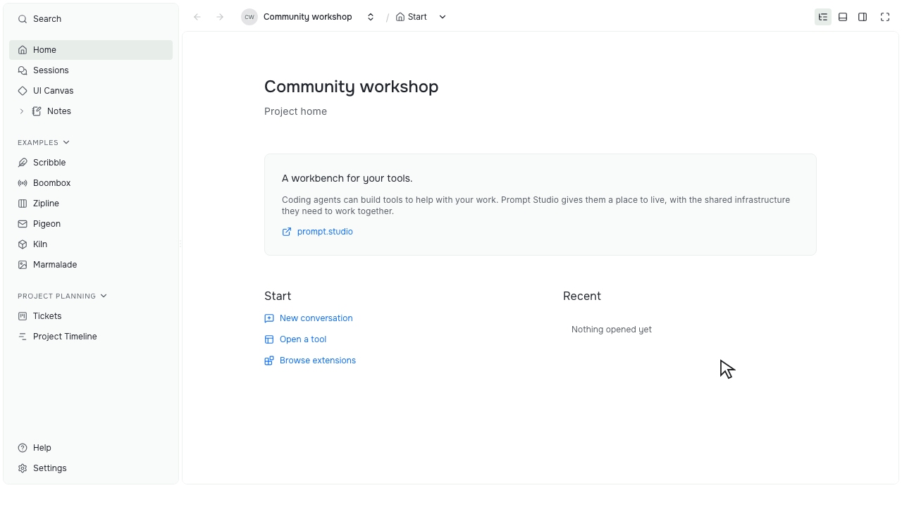

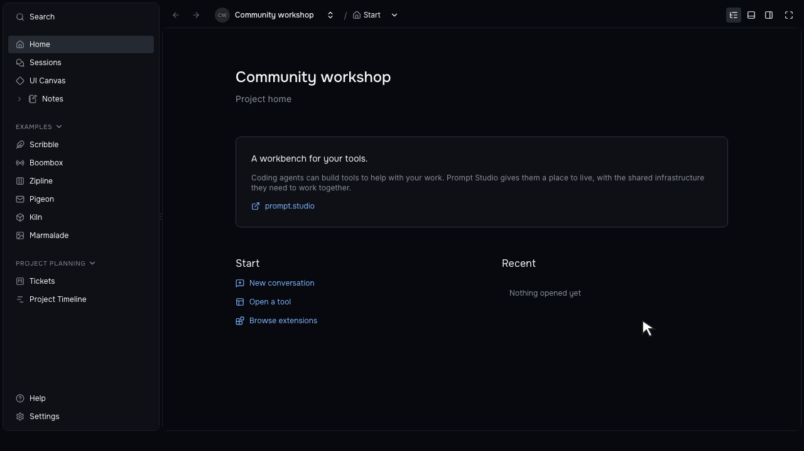

Choose Tickets under G → K, then use C → T to open the ticket creation form. Numbered choices resolve shortcuts shared by several tools.

Ctrl+Tab moves between tabs across panels. Numbered tab shortcuts, panel toggles, and Main fullscreen work from embedded tools too, so you can keep your hands on the keyboard.

## Independent panel views

Keep a tool's browser in one panel and its open items in another. Home, Sessions, Tickets, and Timeline use page content without an extra tab strip; resource viewers keep their own movable, pinnable tabs.

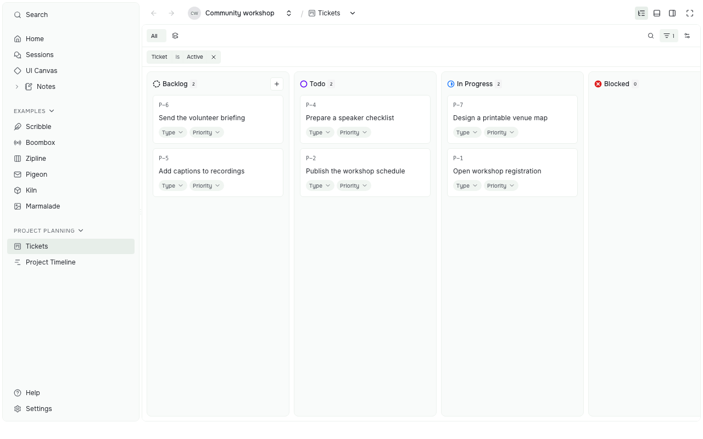

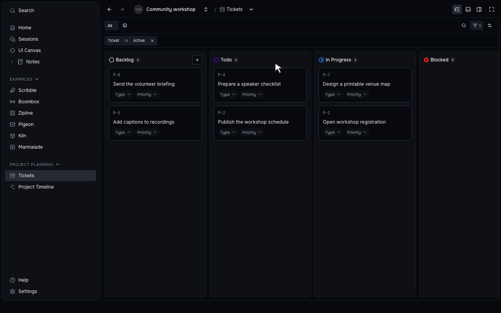

Move the ticket into Side, then return to the board in Main.

## UI Canvas

The optional UI Canvas extension puts live component examples and design pages inside Prompt Studio. Compare variants and themes side by side, inspect props and source, and keep the canvas layout between visits.

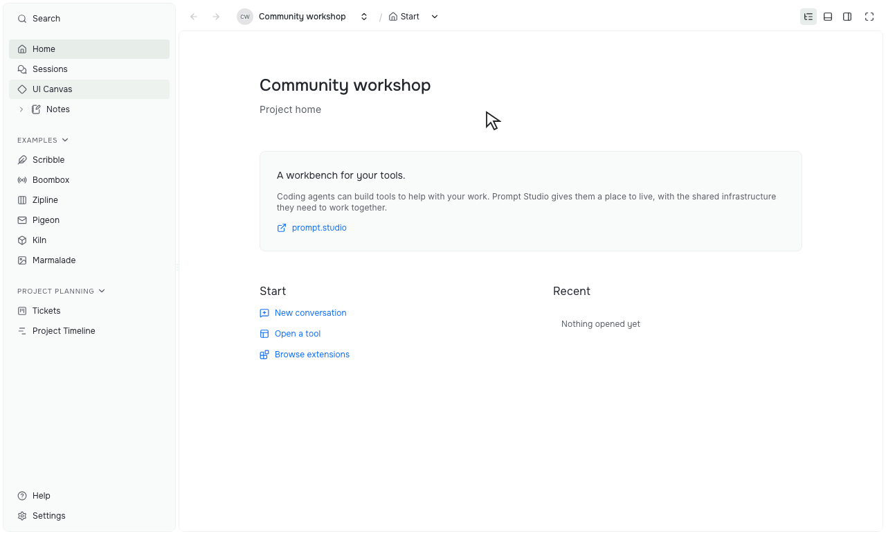

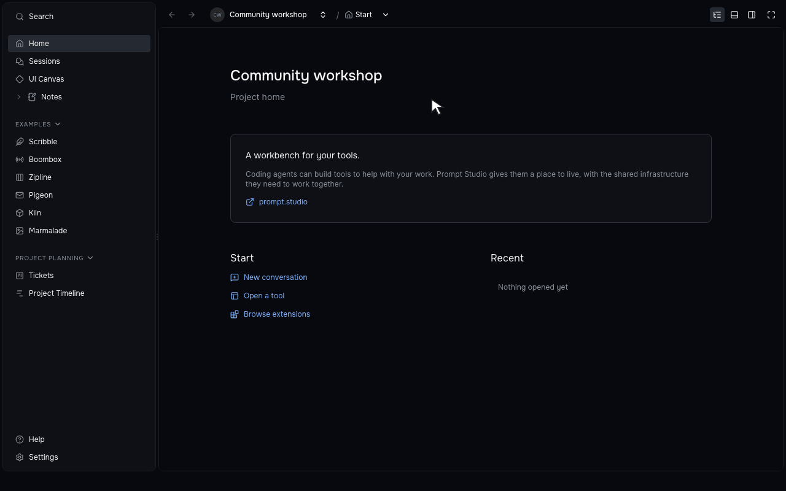

Open UI Canvas, choose a canvas, and try a component with sample data.

For your own React project, `@pstdio/canvas` builds colocated `.canvas.tsx` files into previews and watches their dependencies. See [UI Canvas: work on the interface together](/blog/ui-canvas/) for the workflow.

## Install and connect an agent

Prompt Studio can install private agent CLIs and guide you through provider sign-in inside the app. Existing installations take precedence, and completing sign-in refreshes the session without restarting Prompt Studio.

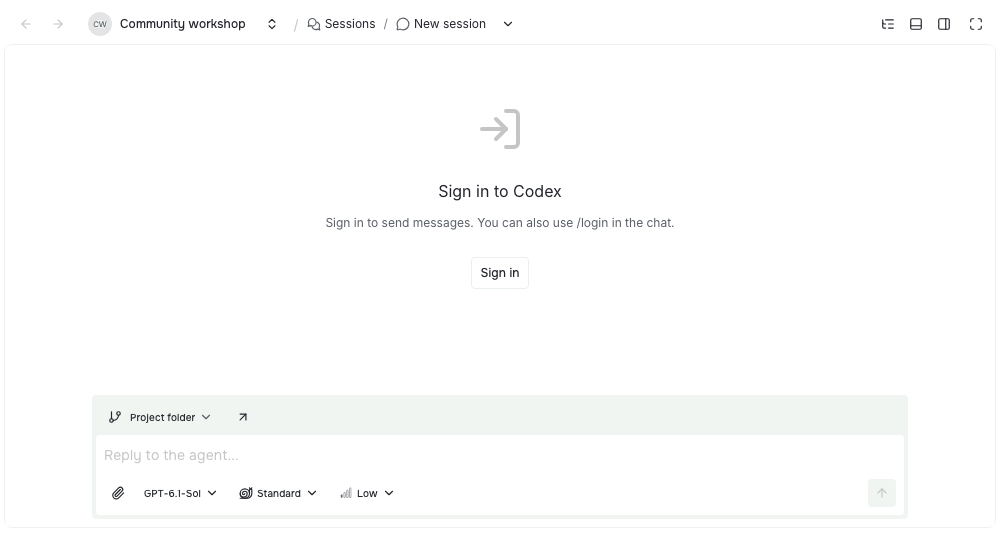

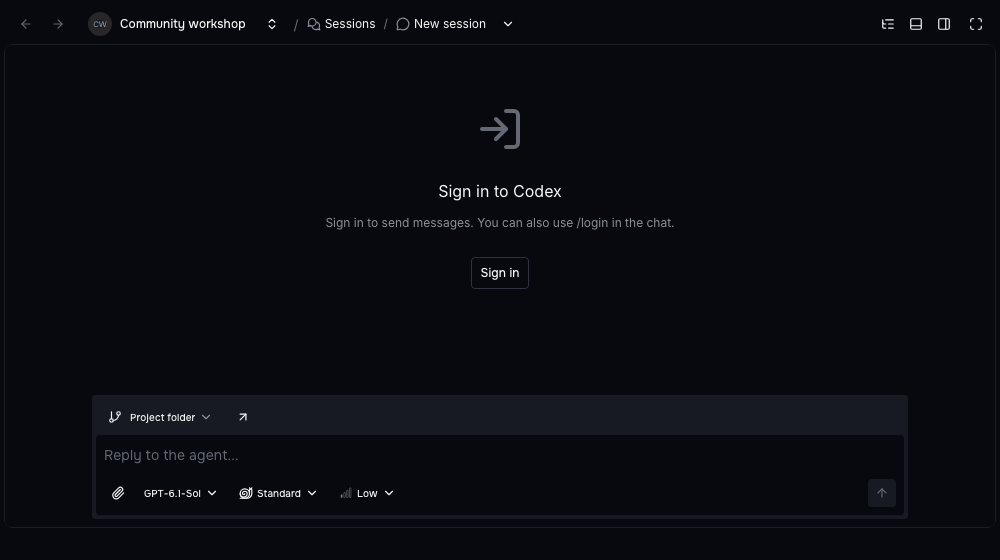

Start from the session's setup controls to connect your agent account.

The optional Pi extension adds another agent choice, with streamed text, reasoning, tool results, and resumable conversations. It asks you to trust a workspace before loading its project instructions and tools.

## Steer an active session

With Codex, you can send a correction while the agent is working. Drag a queued message onto **drop here to send now** to pass it into the active turn.

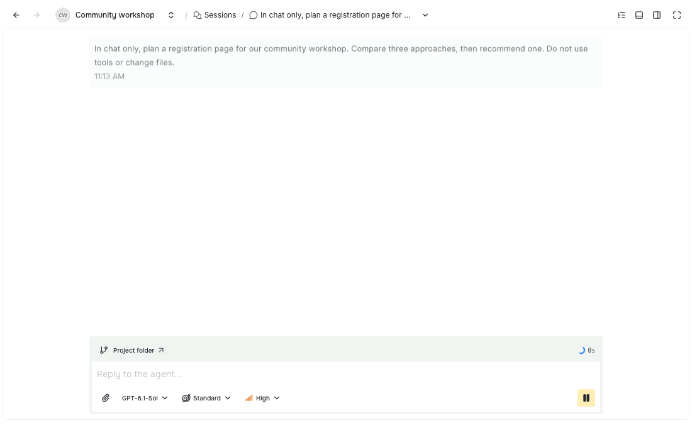

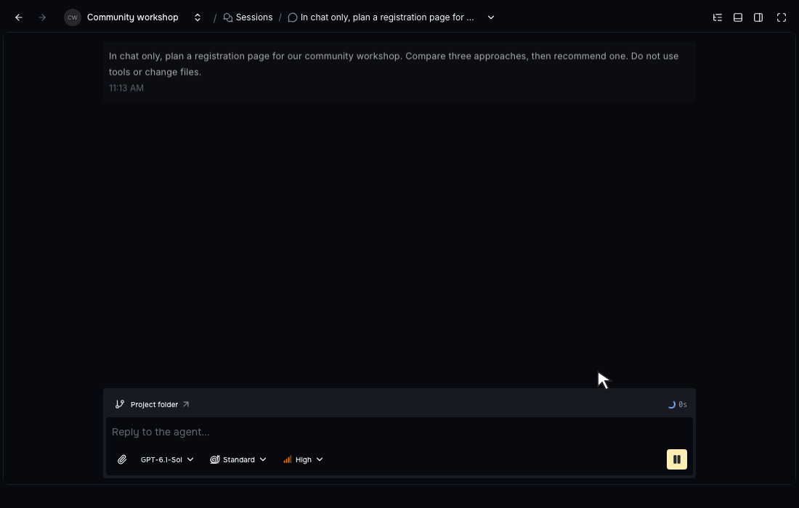

Queue a correction, then drag it above the queue to steer the current work.

Codex also supports Fast speed. Claude Code shows plan approval in the conversation and continues after you approve it.

## Project Planner Auto Build

Configure Auto Build in one dialog, including the ticket filters and statuses it should work with. Pause and resume the same run, and open its activity to see what is running or waiting.

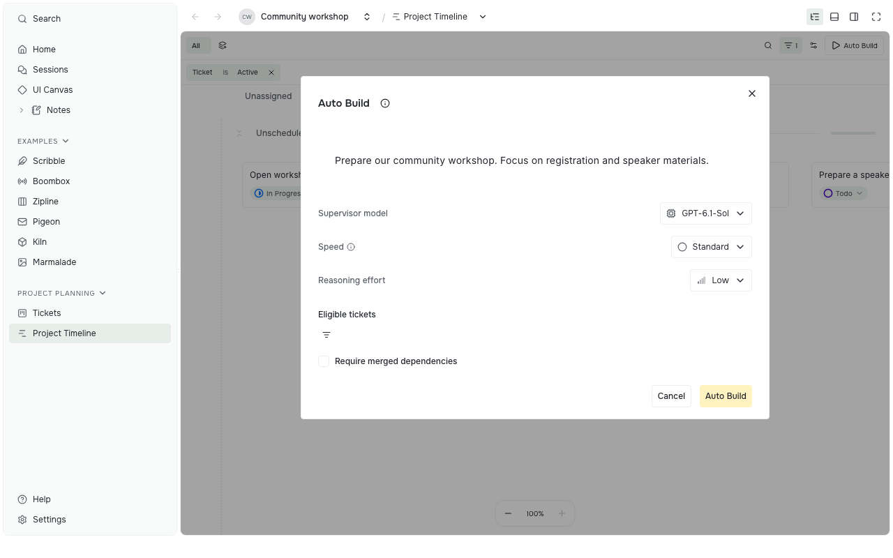

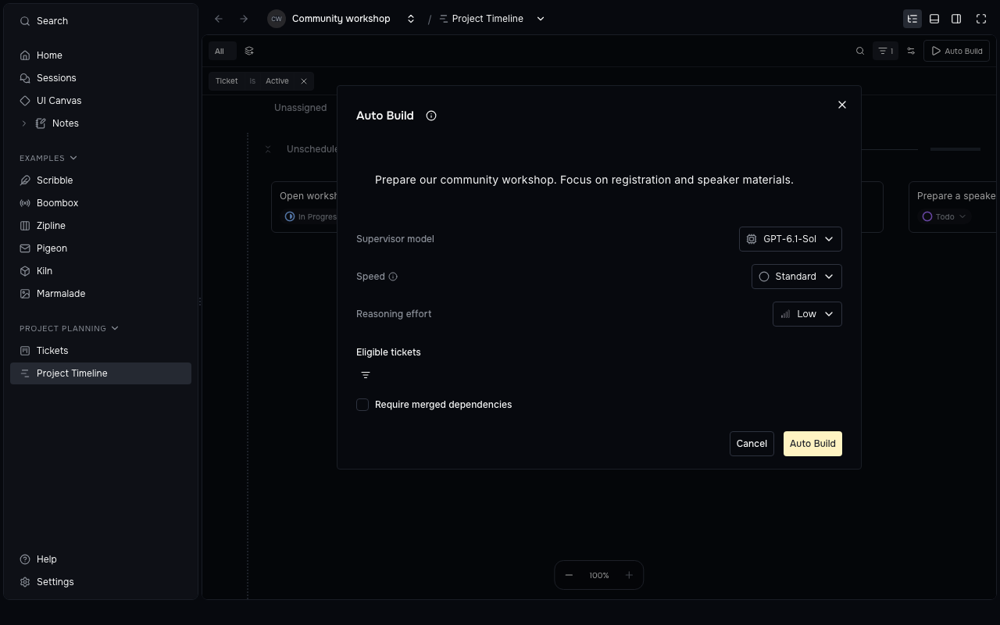

Choose the work Auto Build should take on before starting it.

Needs attention can stay beside Tickets or Timeline. Timeline remembers milestone visibility and collapsed groups, and agents can maintain Planner progress through its public commands.

## Preparing for cross-device sync

We continue to prepare for cross-device sync, with work on encrypted project data, recovery, and offline changes.

- Restoring project records and published extension packages on another device, while keeping private local overrides local.
- Merging offline tag edits and preserving earlier ticket and report numbers after conflicts.
- Keeping local recovery points for project data.
- Assigning scheduled automations to a device and recording missed runs without replaying them in a burst.

## Extension API 0.3

Records now hold small structured data, with large content stored as files. API 0.3 refuses records above **256 KiB** and commits above **4 MiB**; a refused commit writes nothing.

Keep a long report outside its record while retaining a small reference you can query.

```ts
const report = ctx.storage.scope({
  type: "resource",
  id: "report-release-review",
});
const file = await report.files.put({
  name: "review.md",
  mimeType: "text/markdown",
  data: new TextEncoder().encode(body),
});
await report.records.commit({
  operationId: crypto.randomUUID(),
  edits: [{
    recordId: "summary",
    replace: {
      title: "Release review",
      bodyFileId: file.id,
    },
  }],
});
```

Update extension manifests to `engines.pstdio: "^0.3.0"` after adapting and checking their storage use. `storageLimits` and `isStorageLimitError` expose the limits and errors; `ctx.storage.readLegacy` now always returns `undefined`.

- Indexed record pages, aggregate counts, and batch reads let tools request the data they need without loading every record.
- Extensions can control project sessions, stream conversations, handle approvals and attachments, and invoke native agent commands.
- App-wide panels, device settings, shared keyboard actions, and status-bar detail popovers are available through public APIs.
- Core extensions now have independent versions and releases. Their host API requirements determine which versions can be installed together; PSX registry installs are opt-in.

See the [API 0.3 migration guidance](../../../../../documentation/references/extensions/0014-api-versioning.md#storage-size-limits-in-api-03).

## Other improvements

- Prompt Contrast Light and Dark add stronger contrast, and contributed themes stay steady when switching projects.
- The Performance Monitoring extension shows frame rate and, in the desktop app, backend response time, CPU, memory, and extension activity. Browser tabs show frame rate only; measurements stay on the device.
- Workspace files open without computing a diff, and workspace edits save explicitly.
- Project Planner stores ticket file bodies separately; Reports does the same for long report bodies.
- Extension Lab adds Marmalade, with drawing tools, editable text, image adjustments, layers, and undo.
- The folder picker hides dot-prefixed folders by default; Cmd/Ctrl+Shift+Period reveals them.
- Linux and Windows keep panel and fullscreen controls beside the native window buttons.
- Desktop and Pi dependencies include security updates.

## Release sources

This post covers merged work and [changesets](https://github.com/pufflyai/prompt-studio/tree/db7145c34ab7cc56ae4c1a97ebdcb0332ef7cfc4/.changeset) through commit [`db7145c`](https://github.com/pufflyai/prompt-studio/commit/db7145c34ab7cc56ae4c1a97ebdcb0332ef7cfc4).

- Upgrade: [database baseline](https://github.com/pufflyai/prompt-studio/pull/1405), [extension ownership and independent releases](https://github.com/pufflyai/prompt-studio/blob/db7145c34ab7cc56ae4c1a97ebdcb0332ef7cfc4/documentation/adrs/0106-independent-core-extension-delivery.md).
- Workbench: [shared shortcuts](https://github.com/pufflyai/prompt-studio/pull/1377), [Alt previews](https://github.com/pufflyai/prompt-studio/pull/1557), [themes](https://github.com/pufflyai/prompt-studio/pull/1566), [UI Canvas](https://github.com/pufflyai/prompt-studio/pull/1381), [project Canvas builder](https://github.com/pufflyai/prompt-studio/pull/1597).
- Agents and Planner: [Codex steering](https://github.com/pufflyai/prompt-studio/pull/1351), [Claude plan approval](https://github.com/pufflyai/prompt-studio/pull/1531), [Auto Build pause and resume](https://github.com/pufflyai/prompt-studio/pull/1347).
- Sync preparation: [new-device recovery](https://github.com/pufflyai/prompt-studio/pull/1317), [extension packages](https://github.com/pufflyai/prompt-studio/pull/1333), [recovery points](https://github.com/pufflyai/prompt-studio/pull/1328).
- API: [version and migration reference](https://github.com/pufflyai/prompt-studio/blob/db7145c34ab7cc56ae4c1a97ebdcb0332ef7cfc4/documentation/references/extensions/0014-api-versioning.md), [SDK changes](https://github.com/pufflyai/prompt-studio/tree/db7145c34ab7cc56ae4c1a97ebdcb0332ef7cfc4/packages/sdk).
