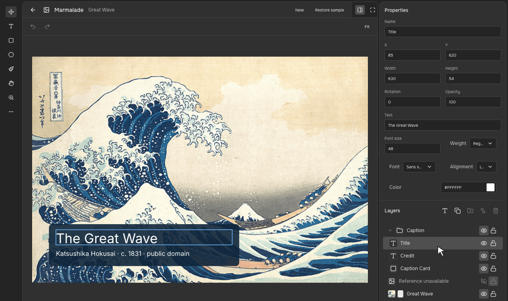
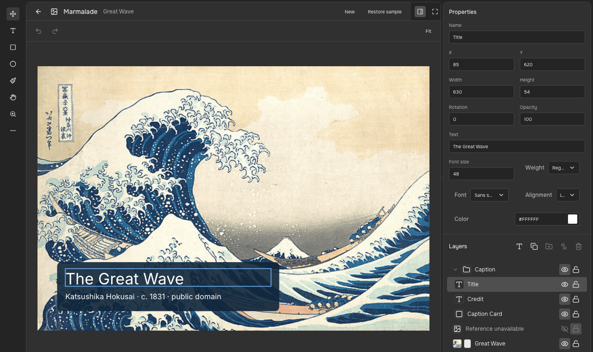
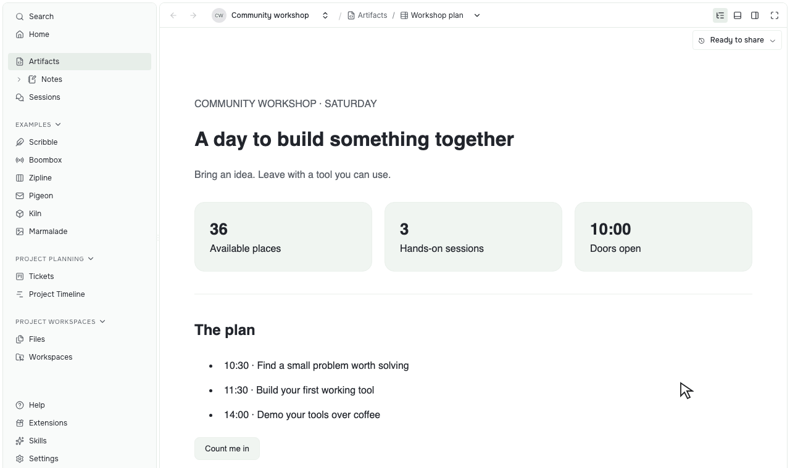
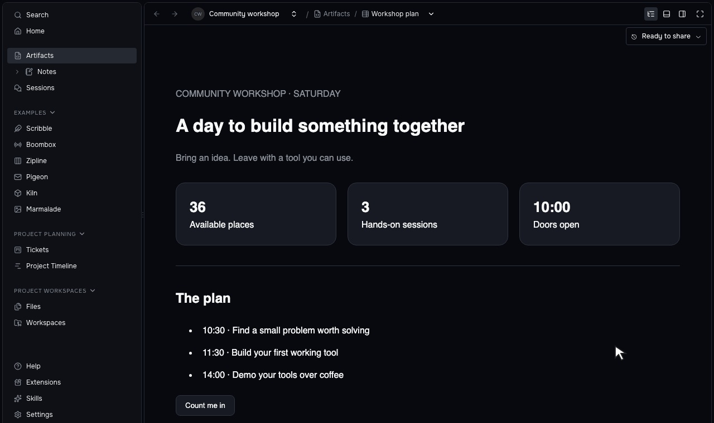
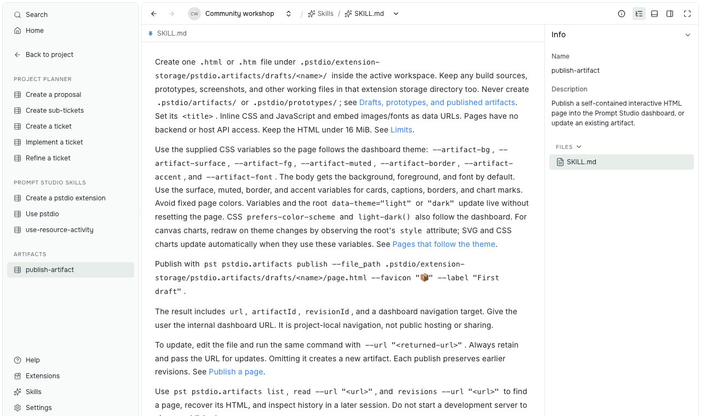
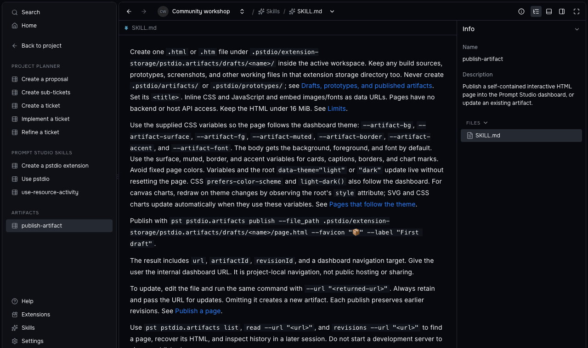
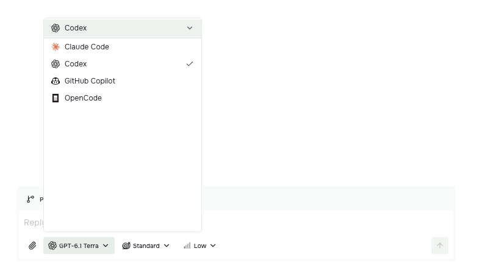
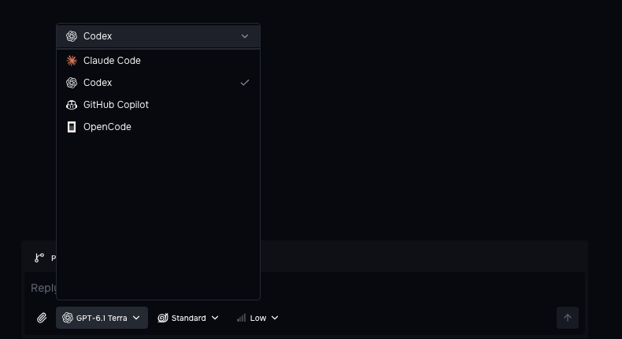

Prompt Studio 0.48 adds rearrangeable toolbars, HTML exports for artifacts, a browser for your agents’ skills, and GitHub Copilot support.

## Arrange your tools

Drag toolbar buttons into the order you use them. Prompt Studio remembers the order, and toolbars adapt when docked along a different edge.

Reorder the tools in this image editor built on Prompt Studio.

You can also reorder buttons with the keyboard using **Alt + Arrow Up** or **Alt + Arrow Down**. The status bar’s compact widgets can be dragged into place, too.

## Export an artifact

Artifacts can now leave the workbench as self-contained HTML files. Choose a saved version, then select **Export HTML** from the artifact’s breadcrumb menu to download it with its interactive content and current theme.

Compare the workshop outline with the finished plan, then export the finished version.

Open the downloaded file in a browser or send it to someone who needs the result. The **Versions** menu keeps earlier snapshots close at hand.

## Browse your agents’ skills

The new **Skill Browser** shows the instructions available to agents in your project.

Read a skill’s instructions alongside its description and files.

Install Skill Browser from the extension catalog or choose it during **Coding** setup, then open **Skills** above Settings. It reads the same skill catalog your agents use, so you can inspect a workflow before asking an agent to run it.

## GitHub Copilot

GitHub Copilot is now available as an optional agent extension. Install **GitHub Copilot**, choose it in a new conversation’s harness selector, and sign in with GitHub CLI or a GitHub token.

Choose the agent from the model menu’s harness selector.

Copilot streams replies, reasoning, and tool calls into the conversation. You can continue or fork its sessions, send follow-up instructions while it works, and use **Ask** permission mode to approve its tool requests. It also reads your project’s Copilot instructions and skills.

## Release sources

This post covers selected features merged for 0.48 through [1679c6e15](https://github.com/pufflyai/prompt-studio/tree/1679c6e15). The [pending release notes](https://github.com/pufflyai/prompt-studio/tree/1679c6e15/.changeset) include the full change list.

- [Native toolbars and status widgets](https://github.com/pufflyai/prompt-studio/blob/1679c6e15/.changeset/tough-donuts-attend.md).
- [Artifact exports and version selection](https://github.com/pufflyai/prompt-studio/pull/2109).
- [Skill Browser](https://github.com/pufflyai/prompt-studio/blob/1679c6e15/extensions/pstdio-skill-browser/README.md).
- [GitHub Copilot](https://github.com/pufflyai/prompt-studio/blob/1679c6e15/extensions/harness-copilot/README.md).
