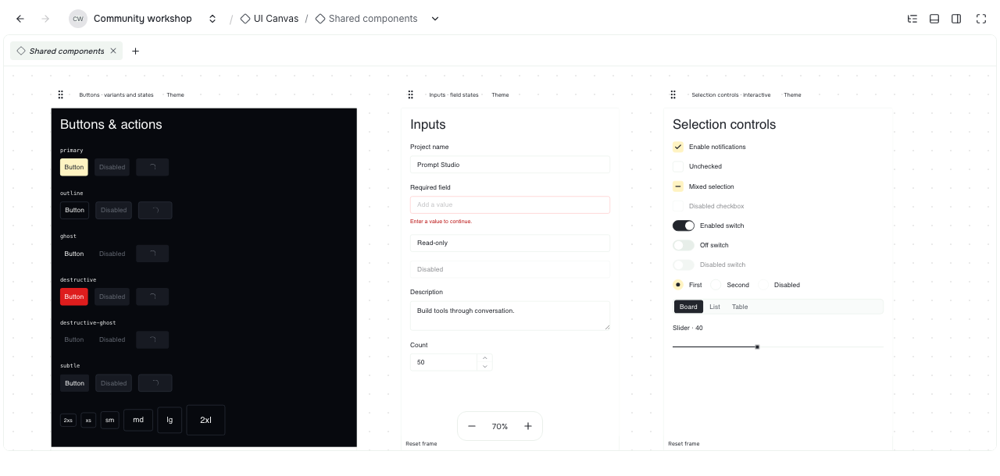
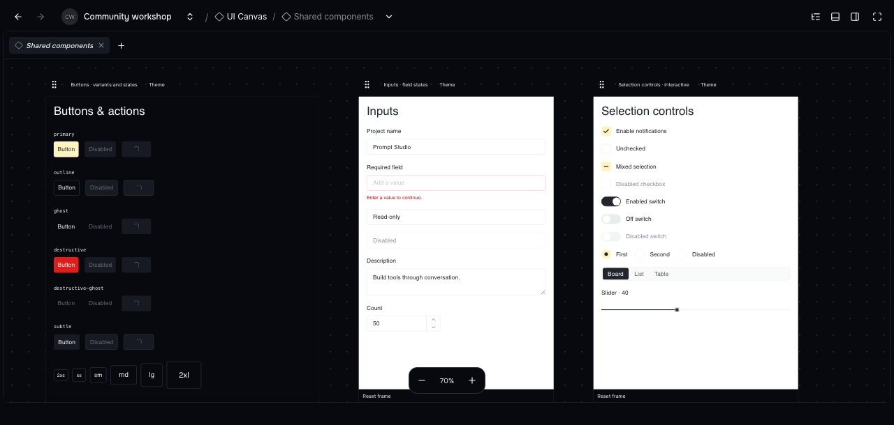
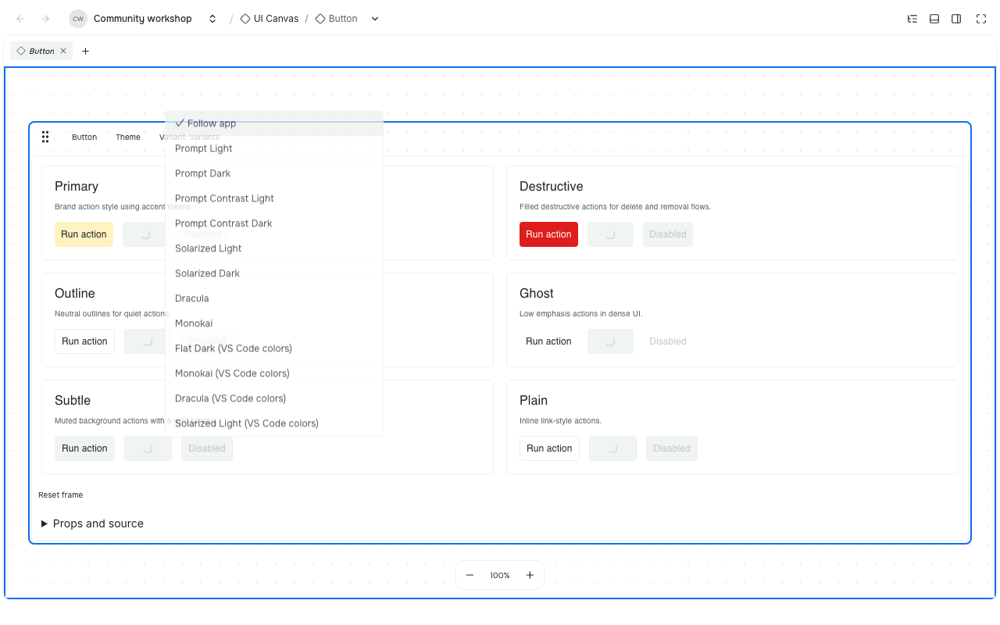
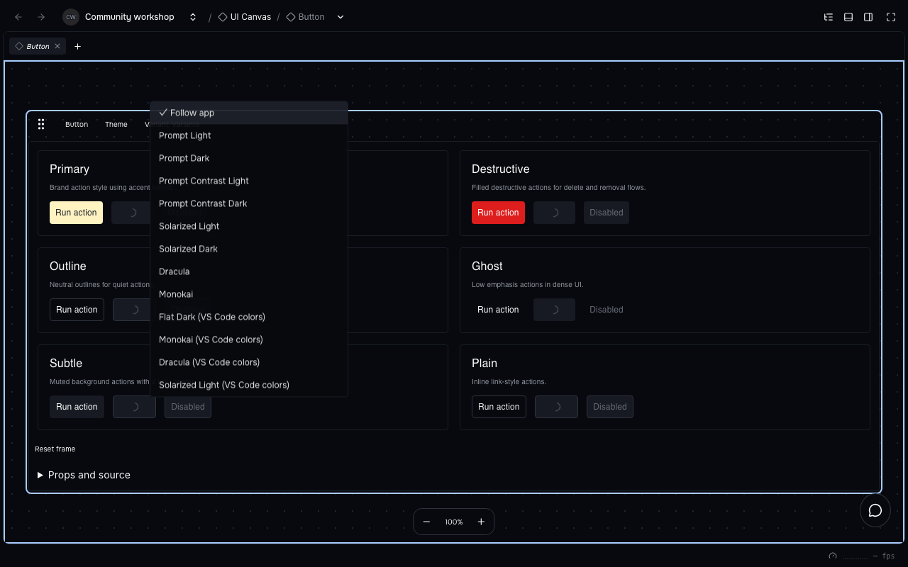
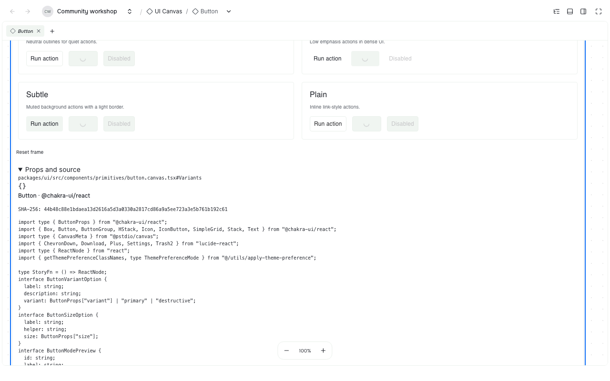
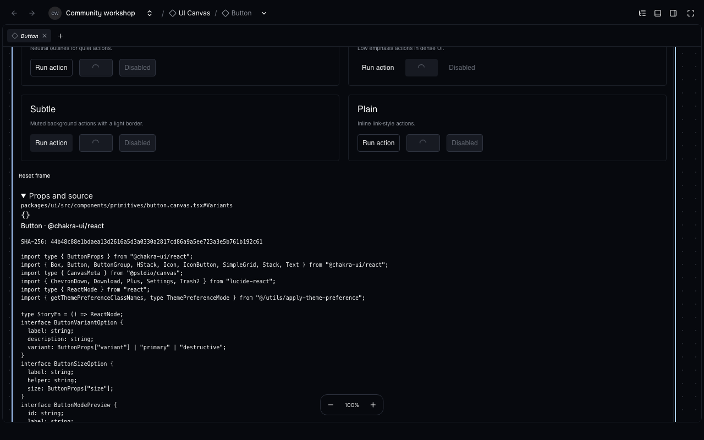

Open UI Canvas, choose an example, and try its controls.

A screenshot can show where a button belongs. It cannot show what happens when you press it, whether a menu stays open, or how a form feels with a long name.

Those details matter when you are building an interface with an agent. You need somewhere to try the work and point to the exact state you want to change.

UI Canvas gives those conversations a place inside Prompt Studio. It puts running components and design pages on a canvas, where you can try them, compare them, and inspect the source behind them.

## Work with the real controls

Install the optional extension with `pst extensions add canvas`. Then open UI Canvas in a project and choose a canvas from the navigation. Each frame contains a working example: you can open menus, type into fields, and try the states the example provides.





The frames run real components with sample data. An example that creates a project does not create a real project in your workspace.

Click a frame once to select it, then use its controls. That first click makes it easier to move around a canvas without accidentally pressing a button inside it.

## Compare states and themes

Use **Variant** to choose a prepared state, such as a long title, an error, or an empty list. Use **Theme** to see that frame in another theme while the rest of the canvas stays as it was.





Try a different state, then compare its appearance in another theme.

Changing a frame's theme keeps its current input. Changing its variant starts that example again, so you can return to a known state.

Drag the frame's handle to move it, drag empty space to pan, and use the camera controls to fit the examples on screen. Frame positions and theme choices are saved for the project; temporary input inside an example is not saved across reloads.

## Give the agent something precise

Click a frame's name to copy it. **Props and source** shows its description, the values supplied to the component, and the source behind the example.





Inspect the example's source before asking an agent to change it.

That makes a request much easier to follow. Instead of describing a button somewhere in the app, you can name the canvas, the component, and the variant you were trying.

Here is a starting prompt:

```markdown
Help me improve this interface using UI Canvas. Find the relevant canvas and tell me which source files own its examples and components.

Keep the existing examples and their IDs. Add a named variant for the change so I can compare it with the current version. Use the project's real components, shared styles, and harmless sample data.

Show me the normal state and the important states people will encounter, such as a long label or a failed action. Let me try the controls. Give me the canvas link, exact preview names, and source paths so we can discuss the same design.

After we agree on the design, update the implementation to match. Check the important interactions and tell me what you could not verify.
```

An installed Canvas contains compiled examples. To change them, the agent needs the project that owns their source; rearranging a frame does not rewrite a component.

## Bring your own React project

UI Canvas can also show examples from your own React project. The companion `@pstdio/canvas` package builds files ending in `.canvas.tsx` with that project's dependencies.

Keep an example beside the component it describes. Ask the agent to make a few useful states, wire in your project's theme, and run the Canvas builder in watch mode while you work.

```markdown
Set up UI Canvas for this React project using `@pstdio/canvas`. Put `.canvas.tsx` examples beside the components and use our existing styles and providers. Start with one component we are actively changing, with a normal state and a useful edge case. Keep generated previews out of Git and show me how to rebuild them.
```

The builder watches the examples and the files they use. UI Canvas reads the compiled result; it does not run arbitrary code saved in a project record.

The [project Canvas guide](../../../../../packages/canvas/README.md) explains setup, examples, and theme providers.

## People and agents share the layout

Agents can list canvases, open one, and inspect its saved layout through the CLI. These commands address the built-in Foundations canvas:

```sh
pst canvas list
pst canvas open --canvas foundations
pst canvas layout read \
  --canvas foundations
```

The browser and CLI use the same layout commands. An agent can arrange examples for a review, and you can open the result and try them yourself.

Component source remains the design record. The saved layout only describes where frames sit, how the camera is positioned, and which themes are selected.
