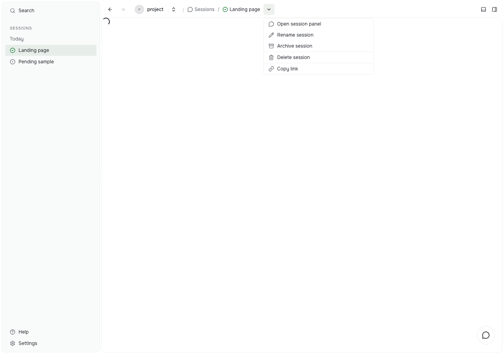

# Sessions

Manage saved conversations from the session breadcrumb or its row in the Sessions or workspace navigation.

This page describes the session menu from the release after 0.43.x. In 0.43.x, you can rename a session from its breadcrumb and archive it with `pst sessions archive --id <session-id>`. Release 0.43.x cannot delete a session.

Choosing **New session** opens its composer. Opening a ticket or workspace previews its latest related session as an unpinned tab. This follows the shared **Open related resources** setting in Appearance, which is on by default. Turn it off to open related sessions only when you choose them. Creating a session from the UI opens it in either setting.

## Open session actions

Select a session, then open the arrow beside its name in the breadcrumb. You can also right-click its navigation row, press Shift+F10 or the Context Menu key, or use the row's touch menu.

The menu acts on that session. Choosing another row's action keeps your current conversation open. New session drafts have no saved-session management actions.

## Rename

Choose **Rename session**. Edit the current name and choose **Run**. The name changes in navigation, the breadcrumb, and open panels. Outer spaces are trimmed. A blank name shows an inline error. Cancel or Escape keeps the current name.

## Archive

Choose **Archive session**, then confirm. Archive keeps the saved conversation and removes it from active lists and recent-session menus. Queued work is cancelled. Running work and work awaiting input continue.

## Delete

Choose **Delete session**, then confirm the named conversation. Deletion cannot be undone. Prompt Studio removes its saved session data and links, while keeping workspace files, linked resources, shared attachments, and external agent history.

Stop active or queued work before deleting. Delete is disabled for running, queued, or awaiting-input sessions. The server also checks that work has stopped and final saving has finished.

Archive and delete close only that session's views. Removing the session on the current page returns you to Sessions. A failed save restores the session and shows one inline error; you can try again.
