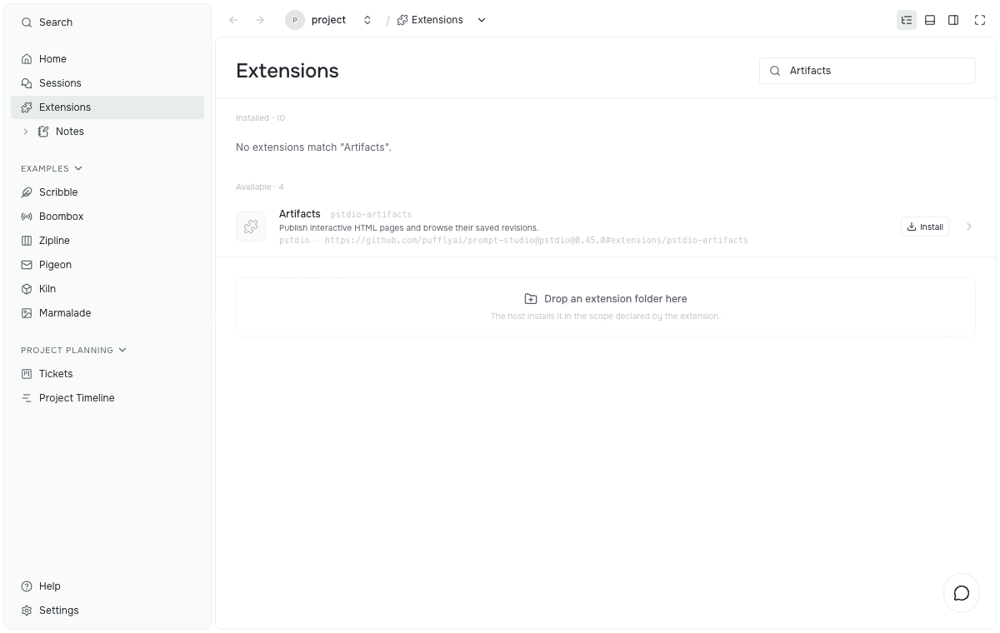
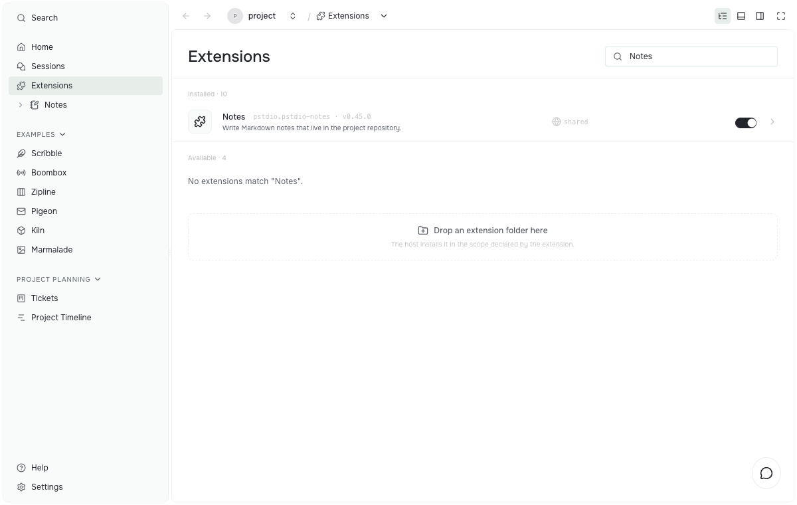

# Add tools

Tools come from extensions. Install an extension once, then turn it on in each project that should use it.

## First-party extensions

Prompt Studio publishes these tools as extensions. They use the public extension API and own their workflows and data. Install the ones you want:

| Extension | What it adds | Install name |
| --- | --- | --- |
| [Planner](../../../extensions/pstdio-planner/README.md) | Tickets, agent attempts, and reviews | `pstdio-planner` |
| [Notes](../../../extensions/pstdio-notes/README.md) | Markdown notes saved in the project folder | `pstdio-notes` |
| [Reports](../../../extensions/pstdio-reports/README.md) | Reports that agents hand to each other | `pstdio-reports` |
| [Artifacts](../../../extensions/pstdio-artifacts/README.md) | Interactive HTML pages with saved revisions | `pstdio-artifacts` |

First-launch setup lets you choose harnesses and default tools. You can skip setup, install tools later, or build your own extensions. Base themes, Prompt Studio Skills, and the installation widget are provided automatically.

## Install from the dashboard

1. Choose **Browse extensions** on the project's Start page. You can also open **Settings** and choose **Extensions** under **Project**.
2. Find the extension under **Available**.
3. Choose **Install**.

The extension is installed and turned on for this project. Its tools appear in the sidebar, in menus, or in the command palette.

Installation continues in the background. Open the puzzle icon in the status bar to see **Installing Extensions**. Each name opens that extension's page. Failed installations offer **Retry**. Completed items show a checkmark. Hide or show this widget under **Settings → Developer tools → Installing Extensions**; hiding it does not stop installation.



Use the search field to find a tool by name. **Available** lists extensions you can install; **Installed** lists those installed for the project or your user. This example shows Artifacts before installation. The list changes as you add extensions.

## Install from the terminal

`pst extensions add` needs a linked project: a folder you opened as a project, which has a `.pstdio/config.json` file. Run the command in that folder or one of its subfolders. If you have no project yet, run `pst projects create` in the folder first. See [Open a project](0002-open-a-project.md). Outside a linked project, the command stops before it installs anything. In 0.43.x the error is "Run `pst extensions add` inside a linked project." From the release after 0.43.x, it starts with `No linked project found from <folder>`, followed by the command to run instead.

Run it with the install name:

```sh
cd ~/my-tools
pst extensions add pstdio-planner
```

The command installs the release that matches your Prompt Studio version and turns the extension on for the project. Prompt Studio uses the `git` command to download first-party extensions from GitHub. Your project folder does not need to be a Git repository.

To install an extension from a folder on your computer, pass a path that starts with `./`, `../`, or `~/`, or an absolute path. The extension folder can be outside the project folder; run the command from the project folder:

```sh
cd ~/my-tools
pst extensions add ~/extensions/my-extension
```

A source counts as a folder path when it is `.`, `..`, or starts with `./`, `../`, `~/`, or `/` (or a drive letter on Windows). Anything else is an install name from the catalog. From the release after 0.43.x, `pst extensions add .` installs the folder you are in, as long as that folder is inside a linked project. Outside one, the command prints the absolute-path command to run from your project folder. In 0.43.x, a bare `.` is read as an install name and fails with "Project not found: .", so pass the folder's absolute path instead.

The CLI sends the folder to the Prompt Studio runtime it is connected to. The runtime installs the extension in the scope its manifest declares and turns it on for the project. In the dashboard, dropping the same folder uses the same installation path. When files already exist, the dashboard asks before replacing them; the CLI requires `--force`.

## Turn extensions on and off

Each project has its own list in **Settings → Extensions**. Use the switch next to an extension to turn it on or off for that project. An extension installed for your user appears in every project. Other existing projects list it as off until you turn it on there. A project you create later starts with every installed extension turned on.

Settings and saved data belong to each project, so two projects can use the same extension in different ways.



The switch controls whether this project uses Notes. Turning it off removes its tools from this project's workbench. It does not uninstall the extension from your user.

## Try an installed tool

After installing Notes, choose **Notes** in the sidebar and create a note. Write a short heading and a list, then close and reopen the note to check that your work is saved. See [Write notes](../../../extensions/pstdio-notes/README.md#write-notes) for the editor and its controls.

Use the same check for a tool an agent builds: try its main action, change something, and reopen it. Tell the agent what happened if the result differs from your request.

## Use extension commands

Tools can expose their actions as CLI commands. That lets an agent use a tool directly, rather than navigate its screen. Run the commands inside your project folder so Prompt Studio uses that project's enabled extensions:

```sh
pst --help
pst pstdio-notes --help
pst pstdio-notes notes create --help
pst pstdio-notes notes create --title "Reading list"
```

With Notes installed and enabled, the last command creates the same empty note as **New note** in the sidebar. Open it in Notes to check the result. Planner adds shorter aliases such as `pst tickets list`; an extension's help shows its own paths and aliases.

For extension commands, `--json` returns the execution response, including its success or failure outcome. Agents can read that response and pass returned IDs to later commands. Use `--help` before guessing an action's flags.

When asking an agent to build a tool, ask for **CLI-ready actions** too: commands to inspect its state and perform its main operations, with useful help and results. This keeps the tool usable from its page, from a terminal, and by an agent. [Make actions CLI-ready](../extensions/0007-cli-ready-actions.md) explains the authoring pattern.

## Keep extensions up to date

When an installed first-party extension has a newer release for your Prompt Studio version, its row in **Settings → Extensions** shows **Upgrade**. From the terminal, run:

```sh
pst extensions update
```

## Ask an agent to build your tool

Start with one thing you want to make easier. You can describe the result without writing the extension code yourself. [Set up an agent and install its skills](0004-run-agents.md), then ask it to use the `create-pstdio-extension` skill. For example:

> Build a reading-list tool for this project. Use the create-pstdio-extension skill. I want to add a title and a link, mark an item as read, and keep the list after I close and reopen Prompt Studio. Put it in this project's sidebar. Make the actions CLI-ready: let me and my agents list items, add them, and mark them as read through pst commands. Install it in this project and show me how to use it.

The agent writes and installs an extension. Try adding an item, changing it, and reopening the tool. Ask for changes in the same conversation. A finished agent session is not proof that the tool works; check the result before relying on it.

Tools can work together when their authors expose commands, events, or resource references that another tool can use. Sharing the workbench does not automatically share all of their data.

If you want to write the code yourself, read [Write an extension](../extensions/0001-authoring.md). To learn how extensions load and run, read [Extensions](../concepts/0002-extensions.md).

Next, [run agents](0004-run-agents.md).
