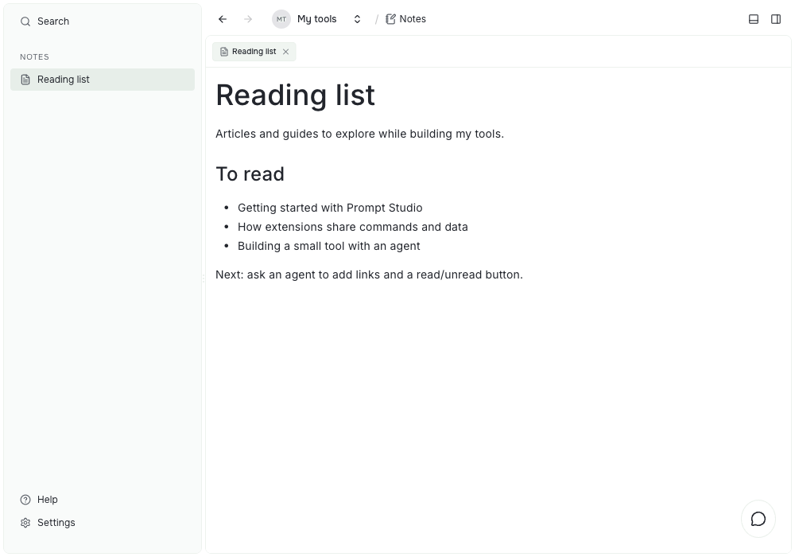

# Notes

Notes lets you write Markdown notes inside Prompt Studio and keeps them as files in your project's local default workspace.

## Install

Notes is not installed by default. Open **Settings → Project → Extensions**, find **Notes** under **Available**, and select **Install**. You can also run:

```sh
pst extensions add pstdio-notes
```

Install Notes once for your user, then turn it on in each project that should use it. Installing from a project turns it on there. Notes needs a ready local default workspace with file access; creating and editing notes needs write access.

## Write notes

Select **Notes** in the project sidebar to open its page. Use its chevron to expand your notes and folders. The tree starts collapsed and stays in the project sidebar when you open a note. Open a note to edit it in the Markdown editor. The editor shows headings, lists, links, tables, and code blocks as formatted text, and saves as you type.



The sidebar keeps your notes within reach while Main shows the note's body. This example is a Markdown note named **Reading list**.

- Choose **New note** next to **Notes**, or next to a folder, to start writing immediately. The note starts empty and is called **New note**.
- **New note** in the command palette also creates and opens an empty note immediately.
- On the Notes page, open **Page actions → New note** to create a note with an optional title and folder ID.
- Selecting a note opens its dedicated page with breadcrumbs and a resource actions menu. Drag the page into Side, Bottom, or an existing tab strip to keep it beside another page. Opening the same note again moves its existing view into Main.
- The first nonempty save gives an untitled note a title from the beginning of its content, up to 80 characters. That title is saved in Markdown front matter and stays unchanged through later edits or clearing the body. A title you choose prevents the automatic rename.
- Right-click a note and choose **Rename note** to change its title. The sidebar, breadcrumbs, and any open tab update. The body stays the same.
- Choose **New folder** next to **Notes** to group notes. Folder names must be unique within the project, ignoring capitalization and surrounding spaces. Drag notes into folders or back onto **Notes** to return them to the root.
- Right-click a folder to rename it or remove it. Removing a folder keeps its notes at the root.
- Use a note's resource actions menu or right-click its sidebar row to rename or delete it. A note moved into a tab offers the same actions in its tab menu.
- Drag a note to the upper or lower half of another note to place it before or after that note. The placement line shows the destination. Notes can move only within the Notes subtree, and the order is saved.
- Find notes by title or content from Search. Selecting a result opens its note page.
- When an agent mentions a note's `content.md` path in a conversation, the link shows the note's title and opens the note in Notes instead of the raw file.
- Every note has its own ID, so two people can create notes with the same title at the same time.

For a first check, create a note, type a heading and a short list, then navigate to another page. Select the note again from the sidebar to see the saved text. You can move the note to Side to keep it beside an agent conversation while you describe the tool you want to build.

Agents can manage notes too:

```sh
pst pstdio.notes create
pst pstdio.notes folders create --title "Research"
pst pstdio.notes notes move --note-id <note-id> --folder-id <folder-id>
pst pstdio.notes create --title "Meeting notes"
pst pstdio.notes rename --note-id <note-id> --title "New title"
pst pstdio.notes delete --note-id <note-id>
```

## Where notes are stored

Each note is a folder in the project's default workspace. The title lives in the Markdown front matter of `content.md`; the editor shows the body:

```txt
<project-folder>/.pstdio/extension-storage/pstdio.notes/documents/<note-id>/
  content.md
  folder.txt    # present when the note belongs to a folder
```

An empty front matter `title` permits the first automatic rename. Existing sidecar titles are preserved and moved into front matter when that note is next saved or renamed. Named folders are stored under `documents/.folders/<folder-id>/title.txt`. Notes keep their IDs when moved. Manual note order is stored in `documents/.order.json`.

Git is optional. In a Git project, commit that folder to share notes with your team, or leave it out of Git to keep them on your computer.

*Updated at: 2026-11-19*
