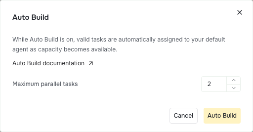

# Auto Build

Auto Build uses a supervisor to assign valid, unassigned tickets using your prompt. It sleeps between checks and resumes when more work can run.

## Start Auto Build

Open **Project Timeline** and click **Auto Build**. Describe how the supervisor should choose work, then adjust the ignore filters below the prompt and click the primary **Auto Build** button.

Starting Auto Build immediately queues a check. The first check starts the supervisor as soon as it finds eligible work; the supervisor then queries its full scope before launching tickets. The queued startup status stays available while that check runs.

For example: “Prioritize small independent tickets for the next release. Leave design decisions for me.”



The ignore list uses the same filter button, picker, and bubbles as Tickets. Tickets matching the filter are excluded. **Backlog** and **Done** are ignored by default. Remove Backlog from the filter if you want those tickets to be considered. An empty ignore list excludes nothing.

The selected timeline view, search, and display filters only affect what you see. The supervisor uses your prompt to select its work scope. Its saved scope and ignore list apply to wake checks, work queries, and dispatch.

**Block on review** is on by default. Turn it off to let dependent tickets start while their prerequisites are in review. Planner combines their submitted commits without merging into the delivery target, and the implementing agent stacks its changes on top. If that combination conflicts, the owner reconciles the code in its assigned workspace before continuing. Missing revisions, requested changes, and ambiguous attempts still prevent a launch. Code conflicts do not create human review requests. Ask for human input only when features, concepts, requirements, plans, or architecture conflict and the existing instructions cannot resolve them.

## Saving settings

Starting a new run saves the settings and clears the old supervisor state in one storage change. Planner sends the settings-change event and queues the next check after that save succeeds. Editing settings during a run keeps its supervisor state.

## How the supervisor works

Planner checks every three minutes and also checks when tickets change or a worker session finishes. When relevant work changes and valid work can run, Planner starts or resumes the supervisor session. A new session receives your prompt and the Auto Build instructions once. Later wakes are short messages asking it to query current work. An hourly reminder explains that progress has stalled. Worker failures, freed capacity, submitted revisions, and answered requests can change the available work. The supervisor's own dispatches are already known to it. Its completion event does not wake it again.

The scheduled check exits before reading tickets or attempts when Auto Build is off. While it is on, the timer checks only attempts dispatched by the current supervisor and their tickets and worker sessions. It resumes a sleeping supervisor when that work changes or sends an hourly stalled-progress reminder. It skips active supervisors and does not scan the project for new work or update ticket statuses. Project and ticket events discover new work; session and ticket events update managed statuses, including when Auto Build is off. Dispatch history stays with its supervisor conversation, so a new conversation starts with no dispatched work.

On its first turn for a new prompt, the supervisor saves the matching track, status, tag, or parent queries with `auto-build scope`. Multiple queries combine as alternatives. Wake checks, `pst tickets next`, and dispatch then use that same scope. An explicit `next` filter can narrow it further. Jobs outside the scope do not wake the supervisor. Prerequisites outside the scope still affect whether its jobs can run. Stopping and starting Auto Build creates a new mode revision and a fresh supervisor session. The new supervisor receives the current brief and saves a fresh scope. Editing the configuration while Auto Build is enabled keeps its current supervisor; the next wake asks it to read the updated configuration and save its scope. Once the scope is current, wakes do not repeat configuration setup or the initial instructions.

The prompt carries instructions, not a candidate snapshot. Work queries return launchable tickets, waiting reasons, capacity, and the current Auto Build revision. The supervisor reads each chosen ticket's full instructions, then launches or resumes its managed attempt. It queries fresh work after dispatching and ends its turn when no relevant work can run. Dispatch rechecks readiness and the saved scope immediately before launching; a change while the supervisor is reading cannot launch an invalid job. Planner reuses the session for later wakes within the same enabled run. Checks leave unchanged work alone while relevant implementation sessions are active. Actionable work can wake an idle supervisor when no relevant implementation sessions are active. After one hour without relevant ticket, attempt, or implementation-start progress, a check can send a reminder even when capacity is full. Reminders are at least one hour apart and never bypass capacity or blockers. The three-minute schedule checks work; it does not send a message every three minutes.

Each new implementation normally uses its own managed Git workspace and the default agent. Its ticket moves to **In Progress** in both Tickets and Project Timeline. The supervisor does not consume an implementation slot. Set **Maximum in-progress tickets** in Planner Settings to control how many implementation sessions can run together.

Tickets must have ready prerequisites and available dependency revisions. Drafts, archived tickets, blocked tickets, review gates, and open human-review requests are not candidates. A ticket already assigned to a running session is excluded. An unattended In Progress ticket without a current attempt can be considered. Completed implementations already in review stay in the normal [attempt workflow](0002-attempts.md).

Dependency waiting comes from `depends_on`, rather than a second text blocker. Planner recognizes the old sentence “Complete PS-123 before implementing this dependent contract.” only when each named ticket is a linked prerequisite. Work queries derive readiness from those links. When the named prerequisites are Done, Planner clears the saved duplicate text on a ticket change, project open, or merge check. Multiple references separated by commas or “and” are also recognized. Other blocker wording and additional instructions remain intact. Clear an independent blocker with `pst tickets update --id PS-123 --blocked-reason ''`; the dependency links stay in place.

Implementation follows the project's Planner settings, including adversarial review and pull request creation. Auto Build does not approve or merge work.

## Inspect or stop Auto Build

The header button always says **Auto Build**. Its dot is green while implementation capacity is in use, yellow while Auto Build is on with no capacity in use, and red if the supervisor fails. Click it to open a compact popover with a separate supervisor row and running ticket sessions, including their statuses. The supervisor says **sleeping** between turns while Auto Build is on. The header shows used capacity and its limit, such as **Running ticket sessions (0/2)**. Click a session to inspect it.

Click the small **Stop Auto Build** button with the pause icon in the popover header to prevent future supervisor prompts and automatic dispatches. Running sessions continue. Stopping does not cancel their work or discard changes. Starting again creates a fresh supervisor conversation and leaves the previous conversation available in session history.

Auto Build keeps working when you close the timeline and resumes its checks after restarting Prompt Studio. Starting it again preserves your prompt, ignore filters, and review-blocking choice.

## When work needs attention

If the supervisor cannot start or resume, Auto Build turns off. Its header indicator turns red, and its popover shows the error. The saved failure does not appear as a timeline error or in a new start form. Resolve the problem and start it again. Existing attempts remain available.

The popover shows a small banner when the supervisor fails or needs input, all running ticket sessions need input, or no work can run because of dependencies, blockers, or review requests. A finished board does not show a blocker banner.

If an implementation needs help, answer every open [review request](0006-review-requests.md). The supervisor can then resume that attempt in the same workspace and session when capacity is available, with your answers included.

An answer is not proof that dependency code was integrated. Planner checks actual Git ancestry even for Done prerequisites. If an existing attempt lacks their submitted code, the supervisor assigns `update-stack` to its current owner before implementation continues. The owner verifies the files, validates the repaired stack, and submits a revision. Repeated reports of the same missing files need stack repair, not another confirmation or an unchanged resume.

When a completed prerequisite has a replacement GitHub PR, Planner checks its most recently linked PR and verifies that its merge commit is included in the selected base. A stale attempt from a deleted workspace does not hide that delivery. An explicitly selected attempt must have a submitted revision that matches the PR head; a merged PR from another variant cannot replace it. An older merged stack-promotion PR cannot substitute for a newer replacement that is still open or absent from the selected base. If GitHub cannot verify the latest PR, the dependency stays blocked. Pending human requests still apply. Each work query shares GitHub delivery reads across its tickets. Later queries and the final dispatch check read fresh evidence.

A missing historical workspace appears as a runnable `recover-workspace` action with its Git error. Dispatch starts a continuation in a fresh managed workspace, seeded from the surviving branch, latest submitted commit, saved event HEAD, or required base. The continuation is linked to the old session when it still exists and receives the saved session, revision, report and PR references to inspect. It can fetch previous code or restart implementation when that code cannot be found. The old attempt and reviews stay as history; the new owner becomes the selected continuation. Unrelated discovery continues, and real dependency, pending-input, ambiguity, assignment and capacity rules still apply.

An unfinished implementation whose session completed, was cancelled, failed, or disconnected can also resume in the same workspace and session. Planner uses the selected attempt, or the sole remaining attempt when no selection exists. Multiple attempts require an explicit selection. Recovery still waits for prerequisites, capacity, and all open review requests. Each stopped turn resumes once. Submitted work is offered as `update-stack` when its workspace has an unrecorded HEAD, its required base differs from the latest revision, or it lacks the current selected dependency base. The supervisor follows up with the existing implementation owner. It does not create another attempt or change an old review verdict.

If nothing starts, check the ignore filters, prerequisites, default agent, and in-progress limit. The supervisor can also leave valid tickets unassigned when they do not match your prompt.

## Agent commands

The supervisor uses public Planner commands:

```sh
pst pstdio-planner auto-build read
pst pstdio-planner auto-build scope --revision <mode-revision> --queries '[{"track":"Workbench"}]'
pst tickets next --track Workbench
pst tickets panel --id PS-123
pst pstdio-planner auto-build dispatch --ticket PS-123 --revision <mode-revision>
```

The scope command saves the work selection for the current mode revision and returns fresh matching work. Use `[{}]` for the whole project. Scope fields combine within each query; the queries combine as alternatives. Set eligibility filters here, rather than temporary priorities. The `next` query reports the current mode revision, launchable `tickets`, `waiting` tickets with reasons and dependency IDs, and capacity. It is read-only and works while Auto Build is off. While Auto Build is on, its filters narrow the saved scope. Prerequisites in other tracks still apply. With **Block on review** off, submitted dependency revisions remain valid stack bases. Requested changes and actively running implementation owners still block new children. The query exposes repair in an existing workspace instead of leaving the track with no actionable work. The implementation owner reconciles conflicting dependency code through `update-stack`.

Dispatch rechecks the mode, ignore filters, assignments, prerequisites, and capacity before launching or resuming work. Use the revision from the latest query. An earlier revision cannot dispatch work after Auto Build is stopped or restarted. The old `pst pstdio-planner auto-build candidates` command is deprecated in favor of `pst tickets next` and remains available through 0.44. Its CLI help names the replacement; it is removed in 0.45.

For work that must build on a feature branch, pass the same `--base <branch>` to `tickets next` and `auto-build dispatch`. This selects the root dependency base for that launch without changing project settings. To continue a linked manual draft, also pass `--workspace-id <id>` to dispatch. Planner preserves its branch and files, requires no managed attempt or active session in that workspace, and tells its new owner to commit the draft and integrate the required base before continuing. Submission still verifies actual Git ancestry. Existing managed attempts keep their owner, workspace, and recorded base; dispatch them without overrides and use `update-stack --base <branch>` in that owner session when the required target changes.
